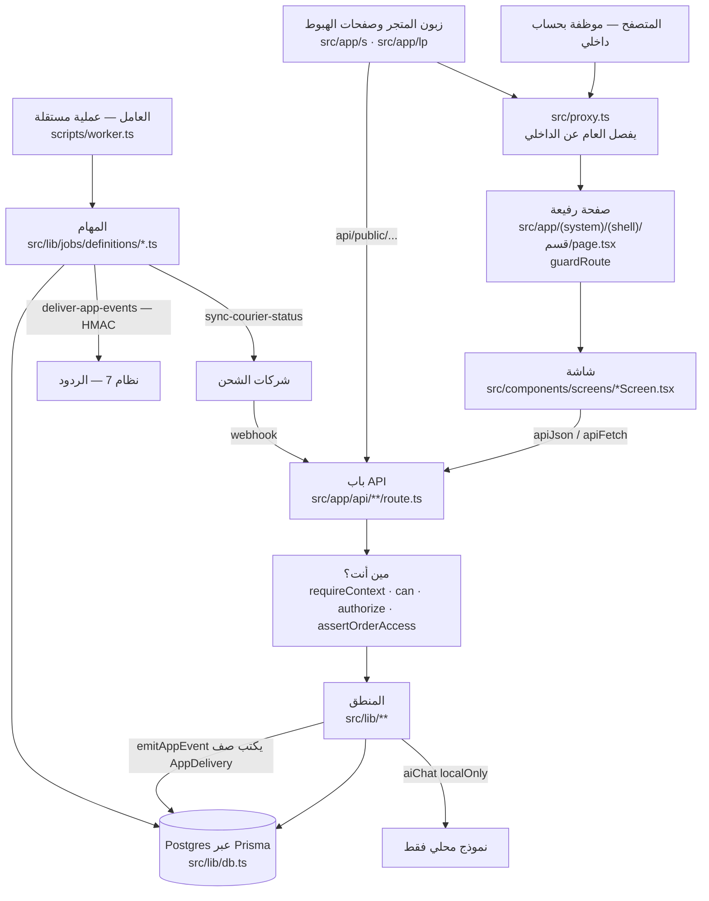
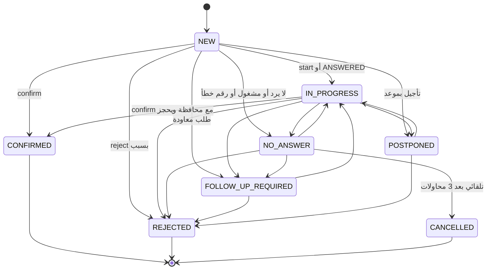
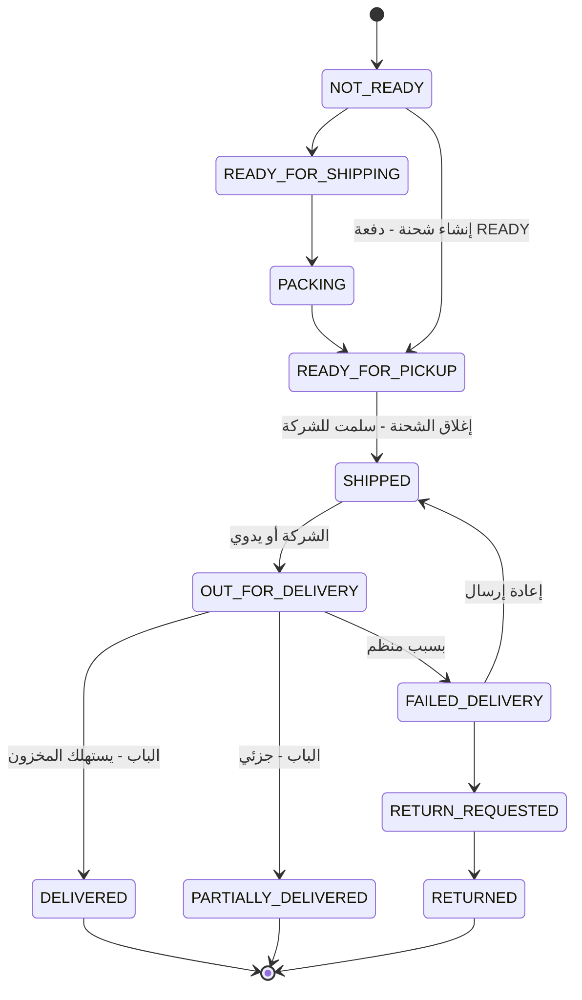
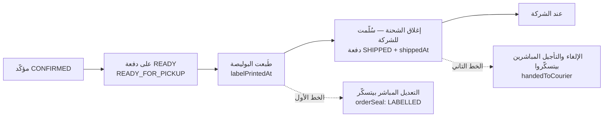
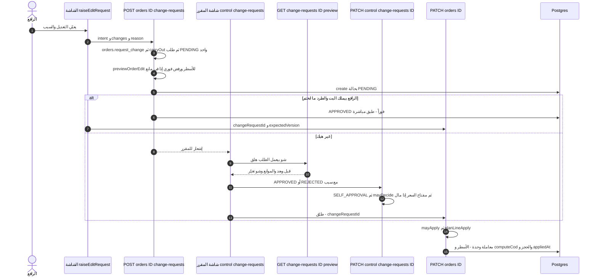
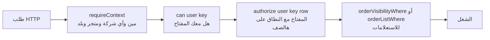

# دليل الكود — نظام الطلبات (OMS) من جوّا

> لمين: مبرمج جديد على المشروع، شغّال مع Claude (Opus 5.5).
> الهدف: تفهم الكود بالتفصيل وتعدّل عليه **بدون ما تخاف**، لأنك بتعرف وين الخطوط الحمرا ومين بيحرسها.
> المصدر: فرع `main` على `iahmed30004000-wq/zaki-ai-OSM`، الكومِت `142708df` (30/10/2026).
> أرقام الأسطر صحيحة على هالكومِت. إذا تزحزحت، دوّر على **اسم الدالة**، الاسم ما بيتغيّر بسهولة.
> هالملف ما بيكرّر `docs/ARCHITECTURE.md` (الخريطة) ولا `AGENTS.md` (القواعد). اقرأهن أول، وهون التفاصيل اللي تحتهن.

---

## 0. قبل ما تبلّش: أربع جمل

1. **السيرفر هو القرار، الشاشة بس بتعرض.** ولا رقم مال ولا حالة بتنحسب بالمتصفح. الحارس `src/lib/the-frontend-invariants.test.ts` بيمسكك إذا حسبت.
2. **كل شي إله بيت واحد.** المال بـ`src/lib/money.ts`، الحجز بـ`src/lib/reservation.ts`، إنهاء الطلب بـ`endOrder` (`src/lib/order-cancel.ts:211`). لا تكتب نسخة تانية، **استورد**.
3. **كل باب بيسأل «مين أنت وشو بتقدر» قبل أي شي.** والحارس `src/lib/every-route-asks-who.test.ts` بيفحص كل handler لحالو.
4. **الاختبار اللي ما بيحمرّ لما تكسر الكود، مش اختبار.** («كسر عن قصد»، القسم 8).

---

## 1. الصورة الكبيرة

### 1.1 المخطط



### 1.2 مثال حقيقي: موظفة بتكبس «تأكيد»

خلّينا نمشي ورا كبسة وحدة من أولها لآخرها، لأنها بتوريك كل الطبقات:

| الخطوة | وين | شو بيصير |
|---|---|---|
| 1 | `src/app/(system)/(shell)/confirmation/...` ← شاشة `ConfirmationMineScreen.tsx` | الصفحة بتنادي `guardRoute(...)` (`src/lib/page-guard.ts:59`) وبترسم الشاشة. الصفحة نفسها سطرين، شوف مثلاً `src/app/(system)/(shell)/orders/page.tsx` |
| 2 | `src/components/screens/ConfirmationMineScreen.tsx:487` (أو نافذة الطلب `src/components/orders/ConfirmationActions.tsx:132`) | الزر بيبعت `POST /api/orders/[id]/confirmation` مع `action: 'confirm'` و`expectedVersion` |
| 3 | `src/lib/api-client.ts:78` (`apiJson`) | إذا الجواب مش ok، بيرمي `Error` رسالته `errorAr` (أو `error`)، وبيحطّ الجسم كامل بـ`e.data`. (`apiFetch` بـ`:29` تحتها: بيحوّل 401 لصفحة الدخول) |
| 4 | `src/app/api/orders/[id]/confirmation/route.ts:52` | `requireContext()` بيرجّع المستخدم والشركة والمتجر والبلد (`src/lib/geo-context.ts:383`) |
| 5 | نفس الملف `:56` | `assertOrderAccess(id, user, ..., ORDER_WORK_DOOR)` — هل الطلب بنطاقك أو بإيدك؟ |
| 6 | `:62` | `authorize(user, 'orders.confirm', order)` — المفتاح + النطاق على هالطلب بالذات |
| 7 | `:113` | `needsContactFirst` — لازم محاولة اتصال قبل أي قرار (`src/lib/confirmation-queue.ts:248`) |
| 8 | `:186` | `needsRegionFirst` — ما في تأكيد بلا محافظة، لأن الأجرة مبنية عليها (`confirmation-queue.ts:304`) |
| 9 | `:278` | `isValidTransition(from, target)` من الجدول (القسم 3) |
| 10 | `:296` | `expectedVersion` إجباري — بيحمي من إنو اتنين يكتبوا فوق بعض |
| 11 | `:369-384` | معاملة وحدة: `order.updateMany` مشروطة بالنسخة، وبعدها `reserveOrderLines` (الحجز) |
| 12 | `:387-403` | سطر بـ`OrderStatusLog` وسطر بـ`OrderActivity` |
| 13 | `:407` | `logAudit` |
| 14 | `:482` بعد الحفظ | حدث `order.confirmed` لنظام 7 عبر `emitAppEvent` (`src/lib/apps/events.ts:59`) — بيكتب صف، والعامل بيبعته |

**الدرس:** الباب بيعمل التحقق والترتيب، والقواعد نفسها (الانتقالات، الحجز، الحدث) عايشة بـ`src/lib`. لما تعدّل قاعدة، عدّلها ببيتها، مش بالباب.

### 1.3 العامل والمهام

- `scripts/worker.ts` عملية لحالها جنب الموقع. بتبلّش من `docker-entrypoint.sh` (السطر 38). إذا العامل واقف، المهام واقفة. وهالشي ظاهر بشاشة المهام.
- كل مهمة بملف: `src/lib/jobs/definitions/<اسم>.ts`، و`index.ts` بيجمعهن. الأسماء والفواصل مثبّتة بـ`src/lib/jobs/definitions-are-pinned.test.ts`.
- مهمة وحدة شغّالة بالمرة الوحدة. هالشي مضمون بقيد بقاعدة البيانات، وفحصه بـ`src/lib/jobs/two-workers-one-job.test.ts`.
- أهم مهمتين لفهم الطلب: `sync-courier-status` (بتسأل شركات الشحن) و`deliver-app-events` (بتبعت أحداث نظام 7).

### 1.4 أحداث نظام 7

- الستة: `order.created` · `confirmed` · `shipped` · `delivered` · `returned` · `cancelled` (`src/lib/apps/events.ts:25-32`).
- `emitAppEvent` **ما بيرمي أبداً** (`events.ts:59-104`). الطلب اللي انحفظ ما بيرجع لورا لأن تطبيق تاني واقع. هو بيكتب صفوف `AppDelivery`، والعامل بيبعتها مع إعادة محاولة (`BACKOFF` بـ`events.ts:50`).
- الشكل `{ event, at, data }` حرفياً (`events.ts:84`). العقد منسوخ بـ`contracts/oms-app-events.v1/` و**ما بيتعدّل هون أبداً**. بتقدر **تضيف** حقل اختياري جوّا `data` وبس. أي شي غير هيك = v2. الاختبار: `src/lib/apps/events.test.ts:181` («the contract the replies system reads»).

### 1.5 الذكاء الاصطناعي: محلي فقط لبيانات الزبون

- الباب الوحيد: `src/lib/ai-provider/` (`index.ts`). النداء بـ`call.ts`.
- `aiChat({ localOnly: true })` بيرمي `AiNotLocal` (`src/lib/ai-provider/call.ts:179`) **قبل أي اتصال** إذا المسار مش `LOCAL` (`call.ts:254`).
- باب الإدخال بالذكاء بيستعمله: `src/app/api/orders/ai-intake/route.ts:129`. وإذا رفض، المحلّل العادي بيكمّل الشغل.
- قاعدة: إذا كتبت نداء جديد فيه اسم أو هاتف أو عنوان، لازم يمرق بـ`localOnly: true`. ومفاتيح الإعلانات ما بتروح لأي نموذج.

---

## 2. شجرة المجلدات المهمة

```
src/
  proxy.ts                    الحارس العام: العام (دخول، متجر، هبوط) مقابل الداخلي
  app/
    (system)/(shell)/<قسم>/   صفحات النظام الداخلي — كل صفحة رفيعة، بترسم شاشة (76 صفحة بكل src/app)
    (system)/login, entry…    الدخول واختيار البلد والمتجر
    api/**/route.ts           الأبواب — 298 باب. كل handler بيسأل مين أنت
    s/ · lp/                  المتجر وصفحات الهبوط — لوكيل المتجر، لا تلمس
  components/
    screens/                  الشاشات الكبيرة (64 ملف) + مجلدات finance/ ops/ confirmation/ …
    orders/                   كل شي حول الطلب الواحد: OrderDetailModal، OrderLinesCard، ChangeRequestReview…
    ui/                       المشترك: Button، Modal، Money، Rows، Pager، Tabs…
    shell/                    الشريط والقائمة والبحث السريع
  hooks/                      useIsPhone · useCan · useMayOpen · usePagedList · useLiveRefresh…
  context/AppContext.tsx      الجلسة والمتجر والعملة للواجهة
  lib/                        المنطق — 483 ملف (بدون الاختبارات)، مسطّح بالأغلب، الاسم بيقلك المجموعة
    couriers/                 محوّلات شركات الشحن والإرسال والنقل والمدن
    jobs/                     العامل والمهام
    apps/                     أحداث نظام 7
    ai-provider/              الذكاء: الباب الوحيد
    v1/                       واجهة الأنظمة الخارجية
  types/auth.ts               SessionUser والأدوار والأسماء القديمة للصلاحيات
prisma/
  schema.prisma               90 موديل
  migrations/                 139 ترحيل — بتنكتب بالإيد، إضافة فقط، مع rollback.sql
scripts/
  worker.ts                   العامل
  ui-inventory.ts/.json       جرد الأزرار والحقول (القسم 8)
contracts/                    عقود منسوخة حرفياً — لا تعدّل
docs/                         ARCHITECTURE.md · ops/DEPLOY.md · ops/PRE-DEPLOY-30-10.md
.github/workflows/ci.yml      الفحص: typecheck · lint · secrets · tests · build · payload budget
```

ملاحظة: عدد الاختبارات حوالي 1187 ملف. كتير منها **جنب الملف اللي بتحرسه** (`money.ts` جنب `money-written-once.test.ts`)، وكتير اسمها جملة بتوصف القاعدة (`a-parcel-in-a-van-is-not-cancelled-by-a-side-door.test.ts`). اسم الاختبار هو أسرع طريق لتفهم ليش القاعدة موجودة.

---

## 3. دورة حياة الطلب

### 3.1 تلات محاور، وحالة وحدة مشتقّة

الطلب بيخزّن **تلات** حالات منفصلة بـ`Order` (`prisma/schema.prisma`):

| الحقل | قيمه | مين بيكتبه |
|---|---|---|
| `confirmationStatus` | `NEW · IN_PROGRESS · NO_ANSWER · FOLLOW_UP_REQUIRED · POSTPONED · CONFIRMED · REJECTED · CANCELLED` (`src/lib/confirmation-workflow.ts:10-13`) | مكتب التأكيد |
| `shippingStatus` | `NOT_READY · READY_FOR_SHIPPING · PACKING · READY_FOR_PICKUP · SHIPPED · OUT_FOR_DELIVERY · DELIVERED · PARTIALLY_DELIVERED · FAILED_DELIVERY · RETURN_REQUESTED · RETURNED · CANCELLED` (`src/lib/shipping-workflow.ts:8-12`) | التجهيز والشحن والباب وشركة الشحن |
| `settlementStatus` | `NOT_APPLICABLE · PENDING_COLLECTION · COLLECTED · SETTLED · …` (`prisma/schema.prisma:858`، `src/lib/finance-workflow.ts:10`) | المالية والكشوف |

وفي **حالة أساسية وحدة** (14 قيمة) **بتنحسب وما بتنخزن**: `deriveCoreState` (`src/lib/order-state.ts:122`). القاعدة: «الشحن بيربح لما يبلّش» — إذا `shippingStatus` غير `NOT_READY` و`CANCELLED`، الحالة من جدول الشحن (`order-state.ts:93-108`)، وإلا من جدول التأكيد (`:110-119`). والمنطقة (`Zone`) كمان مشتقّة (`getZone`، `:79`).

ليش؟ لأن عمود رابع بيقدر «يزحط» عن التلاتة. لا تضيف عمود حالة.

### 3.2 حالات التأكيد

الجدول الرسمي: `CONFIRMATION_TRANSITIONS` (`src/lib/confirmation-workflow.ts:28-37`). أي انتقال مش بالجدول بيرفضه الباب بـ`409 INVALID_TRANSITION` (`src/app/api/orders/[id]/confirmation/route.ts:278-292`)، إلا لصاحب `orders.unlock` مع ملاحظة 5 أحرف على الأقل.



تفاصيل لازم تعرفها:

- `CONFIRMED` و`REJECTED` و`CANCELLED` نهائية **لمحور التأكيد** (`TERMINAL_CONFIRMATION_STATUSES`، `:39`). بعد `CONFIRMED`، الشحن بيستلم.
- `CANCELLED` ما إلها سهم بالجدول. بتوصلها بطريقين: `action: 'cancel'` بمفتاح `orders.cancel` وسبب 5 أحرف (`confirmation/route.ts:225-239`)، أو الإغلاق التلقائي بعد 3 «لا يرد» (`src/app/api/orders/[id]/contact-attempts/route.ts:187-205`، سببه `NO_ANSWER_3_ATTEMPTS`، والحد `NO_ANSWER_LIMIT = 3` بـ`confirmation-workflow.ts:181`). شو بيتعدّ؟ `NO_ANSWER_RESULTS = NO_ANSWER · BUSY · UNREACHABLE` (`:252`).
- **الرفض بلا مكالمة** مسموح لتلات أسباب بس: `DUPLICATE_ORDER · WRONG_NUMBER · OUT_OF_SERVICE_AREA` (`NO_CONVERSATION_REJECTION_REASONS`، `:114`). `FAKE_ORDER` برّا عن قصد، لأنه بيحطّ الرقم بالقائمة السوداء (`confirmation/route.ts:439`).
- أسباب ما بيختارها إنسان: `NO_ANSWER_3_ATTEMPTS · MODERATOR_DATA_ERROR` (`SYSTEM_ONLY_REJECTION_REASONS`، `:90`).
- الكلمات العربية للحالات بمكان واحد: `CONFIRMATION_STATUS_AR` (`:154`). لا تكتب نسخة بشاشة.

**الرفض والإلغاء بيمرقوا بـ`endOrder` دايماً** (`confirmation/route.ts:340-367`). هو اللي بيفكّ الحجز، وبينزّل الطرد عن العربة، وبيبلّغ نظام 7. ممنوع تكتب `confirmationStatus: 'CANCELLED'` بإيدك من باب جديد.

### 3.3 حالات الشحن

الجدول: `SHIPPING_TRANSITIONS` (`src/lib/shipping-workflow.ts:19-51`). الباب: `POST /api/orders/[id]/shipping` بمفتاح `orders.change_status` (`src/app/api/orders/[id]/shipping/route.ts:97`).



- **ما في شحن بلا تأكيد**: `canEnterShipping` (`shipping-workflow.ts:207`)، والباب بيرفض `CONFIRMATION_REQUIRED` (`shipping/route.ts:169-178`).
- **إنشاء الشحنة بيقفز**: `POST /api/ops/shipments` (مفتاح `ops.ship`) بياخد الطلب من `NOT_READY` أو `READY_FOR_SHIPPING` أو `PACKING` (`BATCHABLE_SHIPPING`، `src/lib/batching-guard.ts:20`) وبيحطه `READY_FOR_PICKUP` على دفعة (`src/app/api/ops/shipments/route.ts:381-400`).
- **انشال سهم** `READY_FOR_PICKUP → RETURN_REQUESTED` (28/10)، لأنه كان بيعمل مرتجعات وهمية لطرد لسّا عندنا. وحتى صاحب `orders.unlock` ما بيقدر يرجّعه (`beforeHandoverReturn`، `shipping-workflow.ts:64`، والباب `shipping/route.ts:211`).
- **التواريخ بيحطها السيرفر**: `STATUS_TIMESTAMP` (`shipping-workflow.ts:75`). `PARTIALLY_DELIVERED` كمان بيحطّ `deliveredAt`، وبدونه الكشف ما بيشوف المال.
- **شركة الشحن ما بتقدر تقرّر المال**: `src/lib/couriers/apply-event.ts` هو المكان الوحيد اللي كلمة الشركة بتغيّر فيه الطلب. `DELIVERED · RETURNED · PARTIALLY_DELIVERED · CANCELLED` بيستنّوا إنسان، و`FAILED_DELIVERY` بينكتب ملاحظة بس (`NOTE_ONLY`، `apply-event.ts:66`). والانتقال نفسه بيتفحص بنفس الجدول (`:89`).
- **الإلغاء من الشحن**: بيرجع `shippingStatus` لـ`NOT_READY` والتأكيد بيصير `CANCELLED`. هاد عبر `leavesTheShipment` (`src/lib/shipment-cancel.ts:119`) جوّا `endOrder`.

### 3.4 الختم: خطّين مش خط واحد

هاد أهم مفهوم بالمشروع، وأكتر مكان بيتلخبط فيه الناس. في **لحظتين**، وكل وحدة بتسكّر شي مختلف:



| اللحظة | الدالة | شو بيتسكّر | شو بيضل مفتوح |
|---|---|---|---|
| طباعة البوليصة (`labelPrintedAt`، بينكتب بـ`src/app/api/ops/labels/printed/route.ts:68`) | `orderSeal` ← `reason: 'LABELLED'` (`src/lib/order-seal.ts:130`) | التعديل **المباشر** (بلا طلب) لـ`SEALED_FIELDS`: الاسم، الهاتف، العنوان، المحافظة، الأصناف، السعر، الكمية، الخصم، الأجرة (`order-seal.ts:67-78`) ← `409 ORDER_SEALED` (`orders/[id]/route.ts:1431-1439`) | الملاحظات والحالة والإسناد (ما بتغيّر شي بيعمله السائق). و**الطلب المعتمد** بينعمل بمكانه وبتنعاد طباعة البوليصة، لأن الطرد لسّا عنا (`madeInPlace`، `:1373-1390`) |
| نفسها | `isPacked` (`shipment-cancel.ts:79`) | فكّ حجز الطرد المغلّف **بدون إقرار** | الإلغاء ممكن، بس مع جملة «الطرد بين يديّ — فككتُه وأعدتُ قطعه للرف وأتلفتُ بوليصته» (`ATTESTATION_AR`، `shipment-cancel.ts:32`، وبينبعت كـ`parcelInHand: true`) |
| إغلاق الشحنة (`PATCH /api/shipping-batches/[id]` بـ`status: 'SHIPPED'`) | `handedToCourier` (`order-seal.ts:48`) و`cancelVerdict` (`shipment-cancel.ts:90`) | الإلغاء والتأجيل المباشرين. بعدها الإلغاء = طلب تعديل للمشرف، وبيتبلّغ للشركة. وحتى الطلب المعتمد على حقل مختوم بيرجع `409 COURIER_ACTION_REQUIRED` مع رسالة جاهزة للشركة، لحد ما ينبعت `courierNotified: true` (`orders/[id]/route.ts:1401-1430`) | — |

ليش خطّين؟ قرار المالك (28/10، «M6»): «الإلغاء والتأجيل لغاية ما أضغط إغلاق الشحنة». البوليصة المطبوعة بتثبّت **العنوان والمبلغ**، بس الكرتونة لسّا على أرضنا وبتنفتح. التفاصيل بتعليق `assertCancellable` (`src/lib/order-state.ts:258-303`). هاي الدالة **القديمة الصارمة**، وما في باب إلغاء بيسألها هلق. الأبواب بتسأل `cancelVerdict`.

ضغطة إغلاق الشحنة نفسها (`src/app/api/shipping-batches/[id]/route.ts:192-251`) معاملة وحدة:
- بترفض إذا في طلب إلغاء أو تأجيل معلّق على طرد بالعربة (`:201-212`).
- بترفض إذا العربة فاضية (`:235`).
- بتختم كل الأعضاء بتحديث واحد مشروط، وإذا العدد نقص بترجع كلها (`:237-241`).

### 3.5 مين بيغيّر شو ومن أي باب

| الانتقال | الباب | المفتاح |
|---|---|---|
| سحب الطلب من الطابور | `POST /api/orders/[id]/claim` | `orders.claim` (`claim/route.ts:90`) |
| تسجيل محاولة اتصال | `POST /api/orders/[id]/contact-attempts` | `orders.contact_log` (`contact-attempts/route.ts:80`) |
| بدء، نتيجة، تأكيد، رفض، متابعة | `POST /api/orders/[id]/confirmation` | `orders.confirm`، والنتيجة كمان `orders.contact_log` (`confirmation/route.ts:62`، `:162`) |
| إلغاء من مكتب التأكيد | نفس الباب، `action: 'cancel'` | `orders.cancel` (`:228`) |
| إنشاء شحنة (دفعة) | `POST /api/ops/shipments` | `ops.ship` (`ops/shipments/route.ts:270`) |
| طباعة البوليصة | `POST /api/ops/labels/printed` | `ops.labels` (`labels/printed/route.ts:35`) |
| ترحيل الدفعة لسيرفر الشركة (باركود) | `POST /api/ops/shipments/[id]/dispatch` | `ops.ship` (`dispatch/route.ts:35`) |
| إغلاق الشحنة — سُلّمت للشركة | `PATCH /api/shipping-batches/[id]` | `orders.change_status` (`shipping-batches/[id]/route.ts:129`) |
| تأجيل الشحن، إعادة للمتابعة | `POST /api/ops/shipments/hold`، `.../stand-down` | مفاتيح التجهيز |
| انتقال شحن يدوي | `POST /api/orders/[id]/shipping` | `orders.change_status` |
| نتيجة الباب (مسلّم، جزئي، ما أخد شي) | `POST /api/ops/tracking/deliver` | `ops.deliver` (`deliver/route.ts:84`) |
| استلام المرتجع وعدّه | `POST /api/ops/returns` | `ops.returns` (`returns/route.ts:213`) |
| كلمة الشركة | webhook + مهمة `sync-courier-status` | ← `couriers/apply-event.ts` |
| تعديل حقول قبل التأكيد | `PATCH /api/orders/[id]` | `orders.edit`، والسعر `orders.change_price`، والأجرة `orders.change_fee` (`orders/[id]/route.ts:788`، `:877`، `:1297`) |
| تعديل بعد التأكيد | طلب تعديل (القسم 6) | `orders.request_change` |

قاعدة ذهبية من الكشوف: **كشف الشركة بيكتب المال، والباب بيكتب شو صار** (`src/lib/settlement.ts` وأبواب `src/app/api/finance/statements/`).

---

## 4. المال

> خط أحمر. أي تغيير هون = كلام مع المالك أول + مراجع حساب عدائي مستقل قبل الدمج (`AGENTS.md`، «Fixed blockers»).

### 4.1 الدوال الخمسة

| الدالة | الملف:السطر | شو بتحسب |
|---|---|---|
| `roundMinor(value, minorUnit)` | `src/lib/money.ts:65` | تقريب لخانات عملة البلد (JOD 3، USD 2، SYP 0…)، نصّ لبعيد عن الصفر، بلا انحراف float. `roundMinor(2.675, 2) = 2.68`، `roundMinor(1.2345, 3) = 1.235` |
| `allocateDiscount(lines, discount, minorUnit)` | `money.ts:80` | بيوزّع خصم الطلب على الأسطر **بنسبة قيمتها**. الباقي من التقريب بيروح لأكبر سطر، فالمجموع = الخصم بالضبط. والخصم ما بيتعدّى المجموع (`:83`) |
| `computeCod(input)` | `money.ts:133` | **الحاسبة الوحيدة**: `subtotal`، `discount`، `deliveryFee`، `cod` (المحصَّل)، `revenue`، `addOns`، `discountShares`، `lineTotals` |
| `giftUnits(offer, lineQuantity)` | `src/lib/offer-gift.ts:17` | الهدية **لكل حزمة، مش لكل قطعة**: `freeQuantity × floor(lineQuantity / offer.quantity)` |
| `priceByOffer(offer, quantity, ctx)` | `src/lib/offer-line-price.ts:95` | سعر سطر على عرض: حزم كاملة بسعر العرض + الباقي بالسعر الأساسي + الهدية. وإذا ما في جواب صادق، `basis: 'REFUSED'` مع جملة، ولا رقم معقول أبداً |

وحولهن: `atBasePrice` (`src/lib/line-price.ts:33`، سعر السطر بالسعر الأساسي، اقتراح للصندوق) · `totalsBeforeDiscount` (`money.ts:121`، قيمة السطر قبل خصم الطلب، اللي بيفتح عليها محرّر الأسطر) · `codForOrder` (`src/lib/delivery-fees.ts:76`، `computeCod` من أسطر مخزّنة مع أجرة الشركة) · `moneyText` (`money.ts:215`، للعرض مع فواصل وأرقام لاتينية) · `formatMoney` (`money.ts:166`، للآلة: CSV والبوليصة، **بلا فواصل**).

### 4.2 قواعد `computeCod` بجملة

```
cod     = subtotal − discount + addOns + deliveryFee      (إذا السعر ما بيشمل التوصيل)
cod     = subtotal − discount + addOns                    (إذا priceIncludesDelivery)
revenue = cod بدون الأجرة، أو net − fee إذا السعر بيشملها
```
(`money.ts:149-153`). الهدية (`freeQuantity`) **ما بتدخل بالمال أبداً** (`:17-18`). هي قطعة حقيقية بتنحجز وبتنخصم من المخزون وبتنحسب كلفة، بس سعرها صفر. و`addOns` (العرض بعد الطلب) برّا الخصم عن قصد (`:30-44`).

### 4.3 مثال بالأرقام (عرض «3 + 1 بـ75»، أجرة 5، خصم)

البلد الأردن، `minorUnit = 3`. المنتج سعره الأساسي 25. العرض: 3 قطع مدفوعة + 1 هدية بـ75 للحزمة.

**أ) سطر واحد، حزمة وحدة، خصم 10، أجرة 5، السعر ما بيشمل التوصيل:**

| البند | الحساب | النتيجة |
|---|---|---|
| السطر | `quantity 3`، `unitPrice 25` | قيمة 75.000 |
| الهدية | `giftUnits({quantity:3, freeQuantity:1}, 3)` = 1 × floor(3/3) | 1 قطعة، سعرها 0 |
| الخصم | `allocateDiscount` على سطر واحد | `discountShares = [10]` |
| `lineTotals` | 75 − 10 | 65.000 |
| `cod` | 75 − 10 + 5 | **70.000** |
| `revenue` | 75 − 10 | 65.000 |
| بنفس الطلب لو `priceIncludesDelivery` | `cod` = 65، `revenue` = 65 − 5 | 65.000 و60.000 |

**ب) نفس السطر + سطر تاني بـ30، خصم 10، أجرة 5:**

| | سطر العرض | السطر التاني | المجموع |
|---|---|---|---|
| القيمة | 75 | 30 | `subtotal` 105 |
| حصة الخصم | 75/105 × 10 = 7.1428… ← **7.143** | 30/105 × 10 = 2.8571… ← **2.857** | 10.000 (ما في باقي) |
| `lineTotals` | 67.857 | 27.143 | |
| `cod` | | | 105 − 10 + 5 = **100.000** |

**ج) الباقي من التقريب:** تلات أسطر كل واحد 10، خصم 10، عملة بخانتين: كل حصة 3.33، المجموع 9.99، والباقي 0.01 بيروح لأكبر سطر (أول واحد إذا متساويين) ← `[3.34, 3.33, 3.33]`.

**د) `priceByOffer` بالكميات** (نفس العرض، مكتوبة بتعليق `offer-line-price.ts:21`):

| الكمية المدفوعة | الحساب | `lineTotal` | الهدية | `basis` |
|---|---|---|---|---|
| 3 | حزمة | 75 | 1 | `OFFER` |
| 6 | حزمتين | 150 | 2 | `OFFER` |
| 4 | حزمة + قطعة بـ25 | 100 | 1 | `OFFER_AND_BASE` |
| 2 | أقل من حزمة، العرض بيروح | 50 | 0 | `BASE` |

**هـ) الغلطة اللي صارت وانصلحت:** الباب اليدوي كان بيحسب الهدية `freeQuantity × line.quantity`، فـ«3 + 1» صار 3 + 3. هلق الكل بينادي `giftUnits` (`src/app/api/orders/route.ts:471-472`).

### 4.4 «لا تنسخ، استورد»

- بدك COD؟ نادي `computeCod` أو `codForOrder`. **ممنوع** `sellingPrice * quantity` أو `.toFixed(2)` على مال. كان في نسخة بتضرب السعر بالكمية مرتين، وشوف التعليق بـ`src/app/api/orders/[id]/route.ts:1799-1802`.
- بدك تقرّب؟ `roundMinor` بخانات البلد. `Math.round(x*100)/100` غلط لأن الدينار 3 خانات.
- بدك تعرض؟ مكوّن `Money` (`src/components/ui/Money.tsx`) أو `moneyText`. ممنوع `toLocaleString('ar-EG')` لأنه بيطلّع أرقام هندية.

### 4.5 الحراس اللي بيمسكوك

| الحارس | شو بيحمي |
|---|---|
| `src/lib/one-calculator.test.ts` | حاسبة وحدة لكل رقم: ما في دالة تانية بتجمع كلفة الدفعة، وكل قارئ عروض بيمرق بـ`activeOffersFor`، وما في اسم تاني لفحص الصلاحية |
| `src/lib/every-money-writer-is-known.test.ts` | أي ملف بيذكر `totalAmount · sellingPrice · discountAmount · estimatedCostOfGoods` وبيكتب صف (`.create/.update…`) لازم يكون إما بقائمة `WRITERS` (`:85-118`) وبينادي `computeCod(` أو `codForOrder(` أو `roundMinor(` فعلاً (النداء، مش الاستيراد، `:77`)، أو بقائمة `READS_ONLY` مع سبب مكتوب. ملف جديد برّا القائمتين = أحمر |
| `src/lib/money-written-once.test.ts` | قاعدة تقريب وحدة، والمال اللي بينكتب بيمرق فيها. الحالة اللي فتحته: باب العرض بعد الطلب كان بيقرّب `.toFixed(2)` على الدينار وبيضيّع فلس |
| `src/lib/money-decimals.test.ts` | خانات العملة |
| `src/lib/an-order-is-costed-from-one-place.test.ts` | تكلفة بضاعة الطلب (`estimatedCostOfGoods`) بتجي من مكان واحد: الأبواب التسعة اللي بتكتبها بتسأل `unitCostsOf` (تكلفة الوحدة) أو `fixedCostsOf` (التسليم والنسخ) من `product-fixed-cost.ts`، وما حدا بينادي `productCost(s)` (متوسط الدفعات) غير القائمة المسمّاة بأسبابها. باب جديد بيكتب تكلفة طلب ويقرأ الدفعات بحاله = أحمر. الصفر رقم (`??` مش `\|\|`)، والدفتر (الرف والدفعات وقيمة المخزون) ما بيقرأ الرقم |

إذا حمّر واحد من هدول بتغييرك: **وقّف**. معناها إنك عم تكتب مال الطلب. اكتب للمالك قبل ما تكمّل.

### 4.6 مصدرين للأجرة، و`FEE_SOURCE_DRIFT`

الطلب فيه **عمودين** للأجرة (`prisma/schema.prisma:817` و`:875`):

| العمود | مين بيكتبه | لشو |
|---|---|---|
| `shippingCost` | الإنشاء (`src/app/api/orders/route.ts:393`، `:622`) وتعديل الطلب | هو اللي `PATCH` بيعيد الحساب فيه (`orders/[id]/route.ts:1795-1797`) |
| `deliveryFee` (nullable) | إنشاء الشحنة، من جدول أجور الشركة `resolveDeliveryFee` (`delivery-fees.ts:24`)، وبنفس اللحظة `totalAmount = codForOrder(...).cod` (`ops/shipments/route.ts:396-397`) | «لقطة»: تغيير جدول الأجور بعدين ما بيعيد كتابة طلب حي |

`FEE_SOURCE_DRIFT` = محرّك التعديل لقى `deliveryFee` مش null **ومختلف** عن `shippingCost` (أكتر من نص خانة) (`src/lib/order-line-edit.ts:888-892`). معناها: الحفظ رح يحصّل وحدة منهن بدون ما يقول أي وحدة. فهو **مانع**: ما بيتعدّل مال الطلب لحد ما يتوحّدوا. الجملة: «أجرة التوصيل على هالطلب إلها رقمين مختلفين — ما بنعدّل ماله لحد ما يتوحّدوا.» (`order-line-edit.ts:486`). نفس الرمز بيرجع من التطبيق (`src/lib/order-line-apply.ts:31`) ومن شاشة المقرِّر.

ما تحلّها بإنك تختار وحدة بالكود. هاد قرار مالي.

---

## 5. المخزون والحجز

### 5.1 الفكرة

- **المتوفر = اللي بدفعات الإنتاج − اللي محجوز لطلبات تانية مفتوحة** (`availableStock`، `src/lib/reservation.ts:106`؛ `onHand` `:97`؛ `reservedElsewhere` `:33`).
- الحجز **لكل سطر** (`OrderItem.reservedQty`) وكمان لكل إضافة (`OrderAddOn.reservedQty`)، مش لكل طلب.
- الهدية بتنحجز: الحاجة = `quantity + freeQuantity − reservedQty` (`reservation.ts:231`).
- المخزون **للمتجر** مش للشركة (`:19-30`).

### 5.2 متى بيصير شو

| الحدث | الدالة | وين |
|---|---|---|
| تأكيد الطلب | `reserveOrderLines` جوّا نفس معاملة الحالة | `confirmation/route.ts:382-384` |
| تعديل أسطر طلب مؤكَّد (طلب معتمد) | سطر ما تغيّرت قطعه بيحتفظ بحجزه (`keepReserved`)، والباقي بينحجز من جديد، وبعدها فحص لكل **منتج** `blockedByStock` | `orders/[id]/route.ts:2156-2195`، `order-line-apply.ts:311-316`، `:354` |
| تعديل التجهيز بالدفعة المفتوحة | `reserveOrderLines`، والنقص بيرجّع كل شي | `orders/[id]/route.ts:2170-2175` |
| رفض، إلغاء، إعادة للمتابعة | `releaseOrderLines` جوّا `endOrder` | `src/lib/order-cancel.ts:279`، `reservation.ts:295` |
| تأجيل الشحن ثم الرجوع للقائمة | حجز من جديد مقابل الرف **هلق** | `src/app/api/ops/shipments/hold/route.ts:288-292` |
| `READY_TO_SHIP` | ممنوع إذا سطر واحد مش محجوز كامل | `assertReadyToShip` (`order-state.ts:325`)، `guardLines` (`reservation.ts:315`) |
| التسليم (كامل أو جزئي) | `consumeOrderStock`: القطع بتطلع من الدفعات والحجز بينمسح | `shipping/route.ts:545`، `src/lib/stock-consumption.ts:123` |
| المرتجع | **ما بيرجع للرف** غير لما حدا يستلم ويعدّ ويفحص (`countedAndInspected`)، وبس القطع السليمة | `src/app/api/ops/returns/route.ts:48`، `:402` ← `restoreOrderStock` (`stock-consumption.ts:381`) |

ليش `RETURNED` بيضل حاجز؟ لأن «الشركة قالت رجع» مش يعني إنو الطرد بإيدنا. لو فكّينا الحجز، المتوفر بيزيد بقطع هي بالفان. التعليق الطويل بـ`reservation.ts:58-87` بيشرحها بكلام المالك.

### 5.3 `allowNegativeStock`

إعداد **لكل بلد** (`Country.allowNegativeStock`):

- `false`: السطر الناقص ما بينحجز (`reservation.ts:246`)، فالطلب ما بيقدر يصير جاهز للشحن، والشحنة بترفضه بالاسم.
- `true`: بينحجز وبيتسجّل كنقص للتنبيه اليومي.

بيتسأل **وين الوعد بينعطى** (التأكيد وإنشاء الشحنة). أما التسليم فما بياخد الإعداد وما بيرفض أبداً (`stock-consumption.ts:100-122`): التسليم حقيقة، والنقص بينكتب سطر مراجعة واحد `STOCK_SHORT_AT_DELIVERY` (`:48`).

### 5.4 القفل

الحجز «اقرأ ثم اكتب». بين الخطوتين معاملة تانية بتقدر تاخد نفس القطع (انقاس: 400 + 400 من 500). الحل قفل استشاري لكل منتج (`pg_advisory_xact_lock`، `reservation.ts:163-174`):

- الأقفال **مرتّبة**، فما في deadlock.
- لازم تكون جوّا معاملة، وإلا `assertInTransaction` بيرمي (`:186-190`).

إذا كتبت حاجز جديد: **لا تكتب**. نادي `reserveOrderLines` جوّا `db.$transaction`.

---

## 6. طلب التعديل (`OrderChangeRequest`)

### 6.1 ليش موجود

بعد التأكيد، الطلب للقراءة بس للموظفة. أي تعديل على الحقول أو الأسطر بيرجع `409 CHANGE_REQUEST_REQUIRED` (`orders/[id]/route.ts:1569-1592`). التعديل بيصير طلب، بنيّة (`intent`) من تلاتة: `EDIT · CANCEL · POSTPONE`. والحالة: `PENDING · APPROVED · REJECTED · CANCELLED`، ومعها `appliedAt` (`prisma/schema.prisma`، موديل `OrderChangeRequest`).

### 6.2 مين بيقرّر: `deciderFor` و`mayDecide`

`src/lib/change-request-routing.ts`:

| وين الطلب | المقرِّر (`deciderFor`، `:72`) | مين كمان |
|---|---|---|
| قبل التأكيد (`BEFORE_OPERATIONS`، `:46`) وبإيد موظفة | `HOLDING_AGENT` — الموظفة الماسكته | أي مشرف |
| مؤكَّد والشركة **ما استلمته** (`handedToCourier === false`) | `WAREHOUSE` — مفتاح `ops.decide_changes` (`:91-93`) | أي مشرف |
| غير هيك (عند الشركة، أو ما حدا ماسكه) | `SUPERVISOR` | — |

- «المشرف» = صاحب `control.change_requests` (`:118-120`)، مش اسم دور.
- إذا الطلب بيحرّك **مال** (سعر، خصم، كمية، منتج)، الموافقة بدها كمان `orders.change_price` (`mayDecide`، `:129-144`). والرفض ما بيحتاجه.
- لاحظ: `handedToCourier` إذا ما انبعت بينقرا «انسلّم»، وهي الطريقة الآمنة (`:52-61`).

### 6.3 الرحلة كاملة



**1) الرفع** — `POST /api/orders/[id]/change-requests` (`src/app/api/orders/[id]/change-requests/route.ts:110`):

- المفتاح `orders.request_change` (`:124`).
- `carryOut` بيرفض فوراً الشي المستحيل، مثلاً تأجيل طرد صار عند الشركة (`:203-206`).
- طلب `PENDING` واحد لكل طلب (`:208-217`)، وإلغاء معتمد واحد (`:228-242`).
- طلب **الأسطر** بيمرق بنفس محرّك المعاينة `previewOrderEdit`. أي مانع = `409 LINES_BLOCKED` بجمل المحرّك نفسها، والأرقام المخزّنة هي أرقام المعاينة، **مش أرقام المتصفح** (`:244-308`).
- قيمة «من» لكل حقل بتنقرا من القاعدة، مش من الطلب (`:320-333`).

**2) الاعتماد الذاتي** (`:354-419`): إذا `mayDecide` بتقول نعم للرافع **و**الطرد ما انختم (للـ`EDIT`: `!orderSeal().sealed`، وللإلغاء والتأجيل: `!handed`، شوف `:407`)، الطلب بيصير `APPROVED` فوراً بملاحظة «طُبِّق مباشرةً…». القرار بينسجّل باسمه، ما بيطلع كأنه «نزل معتمد». وهيك المالك بيقدر يعتمد إلغاء طرد مطبوع رفعه بنفسه.

**3) القرار** — `PATCH /api/control/change-requests/[id]` (`src/app/api/control/change-requests/[id]/route.ts:30`):

- الرفض بدو سبب (`:39-41`).
- `SELF_APPROVAL`: ما حدا بيعتمد طلب رفعه بنفسه **من هون** (`:64-69`). الاعتماد الذاتي بس بالرفع.
- `mayDecide` مع `money` إذا الموافقة على مال (`:77-99`).
- الاعتماد **ما بيعدّل الطلب**. بيرجّع `fieldsToApply` والتطبيق خطوة تانية (`:174-178`). والسكوت عمره ما بيعتبر موافقة: المهمة `escalate-change-requests` بتصعّد المتأخر.

**4) التطبيق** — `PATCH /api/orders/[id]` مع `changeRequestId` وبس (`orders/[id]/route.ts:577-603`):

- أي حقل تاني معه = `400 STRAY_FIELDS`.
- التعديل **بينبني من جديد** من المعتمد (`expandApproved`)، وبعدها `mayApply` (`:696-713`).
- إذا بيمس البضاعة، `planLineApply` (`src/lib/order-line-apply.ts:245`) بيحكم على **القرار**، مش على مسودة. ما بيعيد التسعير من عروض اليوم. بيرفض بدل ما يخمّن، والرموز بأول الملف (`order-line-apply.ts:18-34`):

| الرمز | معناه |
|---|---|
| `LINES_STALE` | سطر بالطلب مش متل ما انسجّل وقت الرفع |
| `TOTAL_CHANGED` | الطلب مع التعديل ما عاد بيطلع نفس المجموع اللي شافه المقرِّر |
| `FEE_SOURCE_DRIFT` | أجرتين مختلفتين (4.6) |
| `COD_DRIFT` | المجموع المخزّن مش مجموع الأسطر |
| `STATEMENT_LINKED` | كشف شركة ماسك الطلب |
| `LINES_COMMITTED` | سطر انسلّم أو رجع |
| `CANCEL_AND_REORDER` | الشركة معها الطرد: ألغِ واطلب من جديد |
| `PRODUCT_INACTIVE` | منتج انطفى من وقتها |
| `STOCK_SHORT` | الرف ما بيكفّي |

**5) الكتابة** — معاملة وحدة (`orders/[id]/route.ts:2004-2195`):

- ختم `appliedAt` **جوّا نفس الكتابة** بشرط `appliedAt: null`. كبستين «طبّق» = رابح واحد، والتاني `ALREADY_APPLIED` (`:2012-2017`).
- `linesAreStill`: الأسطر لسّا متل ما قراها المخطّط (`:2127`).
- الأسطر بتنمسح وبتنكتب من جديد بـ`computeCod` نفسه. الهدية هي اللي اعتمدها المقرِّر. ومين ضاف السطر بيضل محفوظ (`:2142-2162`).
- الحجز: سطر ما تغيّرت قطعه بيحتفظ بحجزه، والباقي `reserveOrderLines` ثم `blockedByStock` لكل منتج. النقص بيرجّع كل شي (`:2177-2195`).
- الكلفة التقديرية بتتحرّك بس للأسطر اللي تغيّرت (`costAfterEdit`، `order-line-apply.ts:448`).
- خصم لحاله (بلا أسطر) بيتوزّع من جديد على الأسطر **بمكانها**، بدون مسح، فالحجز والهدية ما بينلمسوا (`:2020-2066`).

### 6.4 شاشة المقرِّر (PR رقم 131)

- الشاشة: `src/components/screens/ChangeRequestsScreen.tsx` على `/control/change-requests` (`src/lib/route-registry.ts:228`).
- لكل طلب أسطر: `src/components/orders/LinesRequestReview.tsx` بيرسم جدول «قبل ← بعد» من `GET /api/control/change-requests/[id]/preview`. هاد الباب **قراءة بس**: ما بيكتب ولا بيقفل ولا بيبلّغ. بيحكم على الأرقام المخزّنة مقابل الطلب **هلق** بنفس أسئلة باب التطبيق، وبيقول شو تغيّر من وقت الرفع.
- المنطق: `src/lib/change-request-review-facts.ts` (الحقائق) و`src/lib/change-request-review.ts` (الأنواع والمقارنة بنص خانة، **بدون جمع أو تسعير**). الجواب ما بيحمل كلفة ولا ربح.
- زر «اعتمد» بيتسكّر إذا الفحص قال مستحيل، **أو إذا ما انفحص**. والرفض ما بيتسكّر أبداً (تعليق `LinesRequestReview.tsx:19-37`). والفحص بيصير بطابور محدود (`src/components/orders/preview-queue.ts`) وبميزانية معدّل خاصة.

---

## 7. الصلاحيات

### 7.1 الطبقات



| الشي | الملف | الملاحظة |
|---|---|---|
| المفاتيح ونصوصها | `src/lib/permission-catalog.ts` (`PERMISSION_MODULES`، `ALL_CATALOG_KEYS` بـ`:505`) | آمن للمتصفح. كل مفتاح: `key · ar · en · scopes? · requires? · note? · opens?` (`:9-30`) |
| الأسماء القديمة | `src/lib/permission-aliases.ts` (`LEGACY_ALIAS`) | `can` بيقبل الاسم القديم كمان (`authorization.ts:79`) |
| `can(user, key)` | `src/lib/authorization.ts:65` | «معك المفتاح؟» بدون نطاق. حساب غير `ACTIVE` = لا |
| `getPermissionScope` | `authorization.ts:94` | النطاق: `ALL_COMPANY · ASSIGNED · OWN · CATEGORY · SPECIFIC` |
| `authorize(user, key, row)` | `authorization.ts:160` | المفتاح + الشركة + النطاق على الصف. للطلبات `orderMatchesScope` (`:114`): `ASSIGNED` = مسند أو ماسك أو مالك أو مدخل، و`OWN` = هو المدخل |
| `requirePermission(key)` | `authorization.ts:190` | بيرمي `Forbidden: ...` و`apiErrorResponse` بيحوّلها 403 عربي |
| الترتيب | تعليق `authorization.ts:1-21` | `SUPER_ADMIN` كل شي ← «منع» المستخدم نهائي ← «سماح» المستخدم ← الدور ← لا. **ممنوع** أي باب يكتب `if role === 'SUPER_ADMIN'` |

### 7.2 `orderVisibilityWhere` مقابل `orderListWhere`

- `orderVisibilityWhere(user)` (`src/lib/rbac.ts:37`) = **«بقدر أقرا هالطلب؟»**. بنطاق `ASSIGNED` بيشمل طلباتها، واللي دخّلتها، **وطابور السحب** (غير مسحوب، `NEW`، بلا قفل) (`:43-72`). الطابور موجود هون عشان تقدر تفتح الطلب اللي رح تسحبه.
- `orderListWhere(user)` (`rbac.ts:120`) = **«شو بيطلع بقائمة»**. بيشيل الطابور.
- **لا تضيّق `orderVisibilityWhere`** لتخبّي شي من القائمة. رح ترجّع 404 لكل سحب. التعليق `rbac.ts:90-119` بيشرحها.
- `ORDER_WORK_DOOR` (`src/lib/order-work-door.ts:41`) = باب تاني مسمّى: الطلب اللي بإيدها بينفتح بـ`confirmation.work` حتى بلا «عرض الطلبات». وكل مكان بيستعمله مسجّل بـ`the-order-she-holds.test.ts`.
- بالواجهة: `useCan` (`src/hooks/useCan.ts:20`) و`useMayOpen` (`src/hooks/useMayOpen.ts:30`) **للراحة بس**. السيرفر هو القرار.

### 7.3 إضافة مفتاح (الملخص، والوصفة الكاملة بالقسم 9-ج)

مفتاح جديد **بياخد باب من الناس** لحد ما ترحيل يعطيهم ياه. لهيك كل مفتاح جديد بيجي مع ترحيل **إضافة فقط** بيعطيه لكل حدا كان بيمرق من الباب القديم:

- **النمط الأساسي**: `prisma/migrations/20261027000000_sensitive_settings_own_key/`.
  - `migration.sql`: `INSERT … SELECT … ON CONFLICT DO NOTHING` بالتلات أماكن اللي بتعيش فيها الصلاحية: `role_permissions`، و`role_permission_defaults` (اللي بيرجعلها «إرجاع للافتراضي»)، و`user_permissions` (سماح ومنع). «المنع» بينتقل **أول**.
  - كل صف id تبعه ببادئة (`'rv149-'`).
  - `rollback.sql` بيمسح بالبادئة وبيمسح سطر `_prisma_migrations`.
- **نمط أحدث لعدة مفاتيح**: `prisma/migrations/20261030140000_confirmation_split_keys/`، والخريطة بالكود `src/lib/confirmation-split-keys.ts:77`، واختبار «ما حدا خسر باب وما حدا ربح» `src/lib/the-confirmation-split-keeps-every-door.test.ts` (بيعيد تمثيل الـSQL بالذاكرة ويحكم بالمحرّك الحقيقي).

### 7.4 ليش ممنوع `prisma migrate dev`

بيقارن السكيما بالقاعدة، وإذا لقى فرق ممكن **يعرض يمسح القاعدة ويعيد بناءها**. وفي فهارس جزئية فريدة موجودة **بالترحيلات بس**، مش بـ`schema.prisma` (مثال: `prisma/migrations/20260912120000_telegram_order_ingestion/migration.sql:52-53`، و`job_runs_one_running`)، فالفرق رح يطلع دايماً. إذا بدك تعرف القيود الحقيقية، اسأل `pg_indexes` بقاعدتك المحلية، مش السكيما. القاعدة (`AGENTS.md`): الترحيل بينكتب بالإيد، بيتطبّق بـ`prisma db execute`، وبينسجّل بـ`prisma migrate resolve --applied`. وانتبه: النشر بيشغّل `prisma migrate deploy` تلقائياً (`docker-entrypoint.sh:10`). يعني **أي ترحيل بينمرج رح يتطبّق على الإنتاج بأول Redeploy للمالك**.

---

## 8. الحراس والاختبارات

### 8.1 أهم الحراس

| الحارس | شو بيحمي | لما يحمرّ، شو بتعمل |
|---|---|---|
| `src/lib/the-frontend-invariants.test.ts` | الواجهة ما بتحسب COD، أجرة، توزيع خصم، مخزون متوفر، أيام بالطريق، SLA، عمولة، ربح، نسبة تسليم، خطورة، تسوية متوقعة | الرقم بدو ييجي من الـAPI. وسّع الباب، لا تحسب بالشاشة |
| `src/lib/touch-targets.test.ts` | 44 نقطة للإصبع (`h-11` أو أكبر). أي `h-8/h-9/h-10` لازم يكون معه توأم `md:`. والزر اللي فيه tooltip لازم يكون إله `aria-label` | استعمل `Button` (بيعطي `h-11 md:h-8`، `src/components/ui/Button.tsx:169-173`) أو `min-h-11 md:min-h-0` |
| `src/lib/western-digits.test.ts` | أرقام لاتينية دايماً، وما في `ar-EG` بأي منسّق. وكمان ما في `letter-spacing` أو `uppercase` على العربي | `moneyText` أو `Intl` بـ`ar-u-nu-latn` |
| `src/lib/arabic-refusals.test.ts` | الرفض لازم يكون بالعربي، بكلمات الشاشة مش أسماء القاعدة، وبيقول شو تعمل. قائمة الرسائل الإنكليزية الباقية **بس بتنقص** | زيد `errorAr` بجملة فيها فعل |
| `src/lib/nothing-unused-ships.test.ts` | ما في حزمة أو مكوّن أو صفحة أو باب أو تصدير من `src/lib` بدون حدا يستعمله. التصدير الجديد غير المقروء بيحمّر | استعمله، أو امسحه، أو حطّه بـ`PLANNED_BUT_UNUSED` (`:595`) مع سبب بجملة |
| `src/lib/ui-inventory.test.ts` | عدد الأزرار والحقول والأعمدة والبطاقات والنوافذ والأيقونات والروابط والتبويبات بكل ملف = الأساس `scripts/ui-inventory.json` | شوف 8.2 |
| `src/lib/palette-contrast.test.ts` | تباين 4.5:1 لكل زوج نص بكل الثيمات (11 لوحة) | لا تغيّر لون لشاشة وحدة. استعمل المتغيّرات `var(--sys-…)` |
| `src/lib/quality-gates.test.ts` | سقف CSS أول تحميل 94.04 KB (`:415`)، بيتقاس بعد `next build` بخطوة «Payload budget» بالـCI | لا تضيف أصناف Tailwind جديدة بلا لزوم (8.5) |
| `src/lib/css-minify.test.ts` · `src/lib/shop-budget.test.ts` | ضغط CSS المتجر وميزانيته (50 KB) | هاد مسار وكيل المتجر، ما بتلمسه عادة |
| `src/lib/bare-fetch-ratchet.test.ts` | ما في `fetch(` جديد بالمكوّنات والخطافات. الدين معدود لكل ملف (`DEBT`) و**بس بينقص** | استعمل `apiJson`. وإذا شلت واحد، نزّل الرقم بالقائمة |
| `src/lib/every-route-asks-who.test.ts` | كل handler (مش كل ملف) بينادي `requireContext · requirePermission · requireAuth · getCurrentUser · requireSystemToken…` (`:40-41`)، حتى لو نداء واحد لجوّا | زيد الحارس. الباب العام بيحتاج سطر بـ`PUBLIC` مع سبب، وهاد قرار المالك |
| `src/lib/apps/events.test.ts` · `events-sites.test.ts` | العقد مع نظام 7: الأحداث الستة = اللي بالسكيما، والتوقيع والترويسات | لا تعدّل `contracts/`. بس بتضيف حقل اختياري جوّا `data` |
| حراس المال (4.5) و`the-inventory-invariants` · `the-state-invariants` · `the-settlement-invariants` | المال والمخزون والحالة | وقّف واكتب للمالك |

### 8.2 `ui-inventory --write`: متى بيجوز

الفشل بيطلع هيك: «تغيّر عدد «buttons»: src/components/…: 5 → 6»، أو «ملفات جديدة بلا تحديث للأساس».

- **إذا الزيادة مقصودة** (ميزة فيها زر أو حقل جديد): شغّل `npx tsx scripts/ui-inventory.ts --write`. حطّ ملف `scripts/ui-inventory.json` **بنفس الكومِت** مع الميزة، واكتب بتعريف الانتهاء بالـPR وبرسالة الكومِت ليش العدد تغيّر («زر X جديد بشاشة Y»). مثال: PR رقم 135 غيّر سطرين بالأساس مع زر المحافظة.
- **إذا النقص مش مقصود** (زر اختفى بإعادة تنسيق): **ممنوع `--write`**. رجّع الزر. هاد بالضبط الشي اللي الحارس موجود عشانه.
- `--write` عشان «يسكت» الاختبار بدون ما تفهم ليش تغيّر العدد = خطأ مراجعة.

### 8.3 نمط اختبار الباب الحقيقي بقاعدة مزيّفة

المثال: `src/app/api/orders/[id]/the-lines-save-again.test.ts`. الفكرة: **شغّل الباب الحقيقي**، وزيّف القاعدة **بس**.

| شو حقيقي | شو مزيّف |
|---|---|
| `PATCH` و`GET` من `./route` (`:256`) | `@/lib/db` ← `fake.db` (`:248`) |
| `assertOrderAccess` ومحرّك الصلاحيات، والمستخدم بـ`effectiveGrants` متل الجلسة (`:267-279`) | `requireContext` · `logAudit` · `notify` · `pii-alert` (`:249-252`) |
| `computeCod` · `needsContactFirst` · `apiError` | `@/lib/auth` بس `requireAuth` (`:254`) |

قواعد الـfake اللي بتخلّيه صادق:

- **بيرفض يتظاهر**: `findUnique` بـ`select` أو بعلاقة ما بيعرفها بيرمي «not modelled» (`:107-128`). الخطأ الأصلي كان إنو `existing.items` ما موجود بالصف المجرّد، وfake بيحطّه كان رح يخبّي الخطأ.
- `updateMany` بيفحص `version` وبيرفض كتابة ما بتحرّك النسخة (`:129-135`).
- كل نداء بينسجّل مع `db` أو `tx`، فبتقدر تتأكد إنو الكتابة **جوّا المعاملة** وبالترتيب (`:477-488`).
- الأرقام **محسوبة بالإيد بتعليق** جنب التوقّع (`:517-560`، مثال 64.200).
- اختبار الرفض بيتأكد كمان إنو **ما انكتب شي** (`:564-575`).

قالب مختصر للبداية (انسخ الفكرة، مش الملف):

```ts
const { fake } = vi.hoisted(() => ({ fake: { order: {} as Record<string, any>, calls: [] as string[], db: null as unknown } }));
vi.mock('@/lib/db', () => ({ db: fake.db }));
vi.mock('@/lib/geo-context', () => ({ requireContext: vi.fn() }));
import { POST } from './route';
// ... fake.db = { order: { findFirst, updateMany }, $transaction: (fn) => fn(fake.db) } — كل method غير مُنمذَج يرمي
it('refuses X and writes nothing', async () => {
  const res = await POST(new Request('http://x', { method: 'POST', body: JSON.stringify({...}) }), { params: Promise.resolve({ id }) });
  expect(res.status).toBe(409);
  expect((await res.json()).code).toBe('MY_CODE');
  expect(fake.calls.filter((c) => /create|update|delete/.test(c))).toEqual([]);
});
```

### 8.4 «كسر عن قصد»

لكل اختبار جديد:

1. شغّله وهو أخضر.
2. **اكسر الكود عن قصد**: اقلب الشرط، احذف النداء، رجّع الرقم القديم. مثلاً بـ`needsRegionFirst` خلّيها ترجع `false` دايماً.
3. شغّله: **لازم يحمرّ**. إذا ضل أخضر، الاختبار فاضي (vacuous). وهاد صار بهالمشروع أكتر من مرة: حارس بيقرا سطر `import` بدل النداء (التعليق `every-money-writer-is-known.test.ts:64-76`)، وfixture ما بتوصل للشرط.
4. رجّع الكود. واكتب بالـPR شو كسرت وشو حمّر.

الحراس اللي بتقرا نص المصدر بتنادي `stripComments` من `src/lib/guard-source.ts`، عشان كلمة بتعليق ما تنحسب كود.

### 8.5 أخطاء TS اللي بيمسكها الـCI

`vitest` **ما بيفحص الأنواع**. الاختبار بيمرق عندك وبيحمّر بالـCI بخطوة `npm run typecheck` (`.github/workflows/ci.yml:41-42`)، لأن `tsconfig.json` بيضم `**/*.ts` (يعني الاختبارات كمان) و`strict: true`.

| الرمز | معناه | مثال شائع عنا | الحل |
|---|---|---|---|
| TS2532 | `Object is possibly 'undefined'` | `lines.find(...).quantity` | `const l = lines.find(...)!` **بس بالاختبار بعد `expect(l).toBeDefined()`**، أو `?.` |
| TS18048 | `'x' is possibly 'undefined'` | `res.body.order.items[0]` بعد `as` ناقص | ضيّق النوع، أو `if (!x) throw` |
| TS2322 | `Type 'X' is not assignable to type 'Y'` | fixture بـ`status: 'ACTIVE'` بيصير `string` مش اتحاد | `as const`، أو اكتب نوع الـfixture (`SessionUser`) |
| TS2556 | `A spread argument must either have a tuple type…` | `vi.fn((...a: unknown[]) => real(...a))` و`real` إلها معاملات ثابتة | `(...a: Parameters<typeof real>)` |
| TS2352 | تحويل نوع مستحيل بـ`as` | `row as SessionUser` | `as unknown as T`، والأحسن تبني الكائن صح |

إذا جهازك بيتحمّل: `npm run typecheck` قبل الدفع. إذا لا: افتح الـPR، اقرا الخطأ من الـCI حرفياً، وصلّحه بكومِت صغير.

### 8.6 Tailwind بيقرا كل الملفات

Tailwind v4 بيمسح **كل** ملفات المشروع، حتى الاختبارات والتعليقات. اسم صنف جديد بأي مكان بيكبّر الـCSS، ومرة كلّفت 30 بايت مقابل السقف.

- بالاختبار، ابنِ الاسم: `['flex', 'nowrap'].join('-')`.
- بالتعليق، **اوصف** الصنف، لا تكتبه.
- بالشاشة، استعمل أصناف موجودة أصلاً. والألوان دايماً `var(--sys-…)`.

---

## 9. كيف تعدّل بأمان — تلات وصفات

### (أ) إضافة زر بشاشة (واجهة فقط)

1. **لاقي الشاشة**: الرابط بـ`src/lib/route-registry.ts`، بعدين `src/app/(system)/(shell)/<قسم>/page.tsx`، بعدين `src/components/screens/<X>Screen.tsx`.
2. **الزر**: `import { Button } from '@/components/ui/Button'` مع `size="sm"` أو `"md"`. الارتفاع 44 على الموبايل جاهز بالمكوّن (`Button.tsx:169-173`)، وزر الأيقونة بياخد عرض 44 (`:185`). إذا لازم تكتبه بإيدك، قلّد `src/components/orders/ConfirmationActions.tsx:246` (`min-h-11 md:min-h-0`).
3. **النص عربي**، قصير، فعل: «اطبع البوليصة» مش «طباعة». لا `uppercase`، لا `tracking-*`. الأرقام لاتينية.
4. **الموبايل**: `useIsPhone()` (`src/hooks/useIsPhone.ts`) **بس** إذا الموبايل بدو مجموعة أزرار مختلفة، متل `ConfirmationActions.tsx:66-67`. غير هيك، أصناف متجاوبة عادية. ليش؟ رسم نسختين وتخبية وحدة بيعمل زرين بالصفحة.
5. **الطلب**: `apiJson` من `src/lib/api-client.ts`، مش `fetch`. اعرض `e.message`، وهي `errorAr` جاهزة.
6. **الصلاحية**: خبّي الزر بـ`useCan('key')` للراحة. السيرفر لازم يرفض لحاله.
7. **المال والحالة**: اعرض اللي جاي من الـAPI بـ`<Money>`. **ولا عملية حسابية**.
8. **الفحص**:
   ```
   npx vitest run src/lib/ui-inventory.test.ts src/lib/touch-targets.test.ts src/lib/bare-fetch-ratchet.test.ts \
     src/lib/the-frontend-invariants.test.ts src/lib/western-digits.test.ts src/lib/nothing-unused-ships.test.ts \
     src/components/<مجلدك>/<اختبارك>.test.tsx
   ```
   `ui-inventory` رح يقلك buttons +1. هاد مقصود، فشغّل `--write` وسجّل السبب (8.2). واكتب اختبار مكوّن بـtesting-library، وفي أمثلة كتير `*.test.tsx` جنب المكوّنات.

### (ب) إضافة رفض جديد بباب API

مثال حقيقي تقلّده: «ما في تأكيد بلا محافظة» (PR رقم 135).

1. **القاعدة دالة صافية بـ`src/lib`** جنب أخواتها، والجملة ثابت مُصدَّر:
   - `needsRegionFirst` (`src/lib/confirmation-queue.ts:304`)
   - `REGION_REQUIRED_MESSAGE` (`:309`)

   الشاشة والاختبار بيستوردوا نفس الجملة.
2. **بالباب**، قبل أي كتابة أو حجز:
   ```ts
   // src/app/api/orders/[id]/confirmation/route.ts:186-191
   if (needsRegionFirst(order)) {
     return NextResponse.json(
       { error: REGION_REQUIRED_MESSAGE, errorAr: REGION_REQUIRED_MESSAGE, code: 'REGION_REQUIRED' },
       { status: 409 }
     );
   }
   ```
3. **الحالة الصح**:

   | الحالة | متى |
   |---|---|
   | 400 | مدخل غلط |
   | 403 | صلاحية |
   | 404 | مش موجود **أو برّا نطاقك** (نفس الجواب عن قصد) |
   | 409 | الحالة ما بتسمح |
   | 422 | المدخل سليم بس مستحيل التنفيذ |
   | 423 | مقفول بإيد غيرك |

   والرمز `UPPER_SNAKE` وثابت، لأن الشاشة بتقراه من `e.data.code`.
4. **الجملة** بتقول شو تعمل، بكلمات الشاشة. لا تكتب `FOLLOW_UP_REQUIRED`، استعمل `CONFIRMATION_STATUS_AR`. والحارس `arabic-refusals` بيمسكك.
5. **الاختبارات**:
   - اختبار وحدة للدالة الصافية.
   - اختبار باب حقيقي (8.3) بيتأكد من الحالة والرمز و`errorAr`، و**إنو ما انكتب ولا صف**.
   - شوف `src/app/api/orders/[id]/confirmation/no-yes-without-a-governorate.test.ts` و`src/app/api/orders/[id]/no-yes-without-a-governorate-on-the-edit-door.test.ts` و`src/lib/no-yes-without-a-governorate.test.ts`: نفس القاعدة **بكل باب** بيوصل للحالة، مش بباب واحد.
6. **كسر عن قصد** (8.4).
7. إذا الرفض بيمس المال أو إنشاء الطلب أو المخزون: **مراجعة حساب مستقلة**.

### (ج) إضافة مفتاح صلاحية

1. **الكتالوج**: سطر بـ`PERMISSION_MODULES` بـ`src/lib/permission-catalog.ts` بالوحدة الصح:
   - `key` بنمط `قسم.فعل`.
   - `ar` و`en` (الحارس `permission-labels.test.ts` بيتأكد إنهن موجودين وبلا placeholder).
   - `requires` (المفتاح اللي بيفتح الشاشة اللي عليها الزر)، أو `requires: null` مع `note` بيقول ليش.
   - `scopes` إذا إله نطاق.
2. **الباب**: `can(user, 'x.y')`، أو `authorize(user, 'x.y', row)` إذا إله نطاق على صف. والرفض 403 بالعربي.
3. **الترحيل** بمجلد جديد `prisma/migrations/<YYYYMMDDHHMMSS>_<اسم>/`:
   - `migration.sql`: إضافة فقط، `INSERT … SELECT … ON CONFLICT DO NOTHING` من **المفتاح اللي كان الباب بيسأله أمبارح**، بالتلات أماكن، و«المنع» أول. كل id ببادئة خاصة فيك. اكتب بأول الملف قاعدتك: «ما حدا بيخسر باب، وما حدا بيربح باب»، وأي استثناء مقصود بيتكتب بالاسم. قلّد `20261027000000_sensitive_settings_own_key/migration.sql`.
   - `rollback.sql`: `DELETE … WHERE "id" LIKE '<البادئة>%'` بالتلات جداول + سطر `_prisma_migrations`، مع جملة «شغّله بس بعد ما يرجع الكود».
4. **الاختبار**: قلّد `src/lib/the-confirmation-split-keeps-every-door.test.ts`. بيقرا الـSQL كنص، وبيعيد منطقه بالذاكرة، وبيحكم بالمحرّك الحقيقي «كان بيمرق أمبارح = بيمرق اليوم». وشوف كمان `src/lib/nobody-loses-a-door-on-deploy.test.ts` (`GRANTED_FROM`).
5. **على قاعدتك المحلية بس**:
   ```
   npx prisma db execute --file prisma/migrations/<المجلد>/migration.sql --schema prisma/schema.prisma
   npx prisma migrate resolve --applied <المجلد>
   ```
   وقيس الأدوار قبل وبعد، وحطّ القياس بالـPR. **أبداً** `prisma migrate dev`. وإذا أي أداة عرضت مسح أو إعادة ضبط: لا، وقّف، وبلّغ.
6. تذكّر: الدمج بيعني إنو الترحيل رح يتطبّق على الإنتاج بأول Redeploy (`docker-entrypoint.sh:10`). عشان هيك الترحيل الهدّام ممنوع، ولازم مراجعة.

### الملفات «الحمرا»: لا تلمسها بدون إذن ومراجعة

| الملف | ليش |
|---|---|
| `src/lib/money.ts` · `offer-gift.ts` · `offer-line-price.ts` · `line-price.ts` · `delivery-fees.ts` | المال. كل الأبواب بتعتمد عليهن |
| `src/app/api/orders/[id]/route.ts` (**2621 سطر** على `142708df`) | باب الطلب الواحد: تعديل، أسطر، خصم، تطبيق طلبات التعديل، الحجز. وفي اختبارات بتقرا نصّه حرفياً، فتقسيمه بدو إذن ومراجعة حساب |
| `src/app/api/orders/route.ts` · `src/lib/public-order.ts` · `src/lib/v1/order-intake.ts` · `src/lib/telegram/order-creation.ts` · `src/app/api/orders/ai-intake/route.ts` | إنشاء الطلب (بوابات `AGENTS.md`) |
| `src/lib/reservation.ts` · `stock-consumption.ts` · `order-line-apply.ts` · `order-line-edit.ts` | المخزون والأسطر |
| `src/lib/order-cancel.ts` · `shipment-cancel.ts` · `order-seal.ts` · `order-state.ts` · `confirmation-workflow.ts` · `shipping-workflow.ts` | الحالات والختم |
| `src/lib/settlement*.ts` · `wallets.ts` · `commission*.ts` | الكشوف والمحافظ والعمولة |
| `contracts/**` | عقود منسوخة. **ولا حرف** |
| `prisma/migrations/**` القديمة | ما بتتعدّل أبداً. ترحيل جديد بس |
| `src/app/s/**` · `src/app/lp/**` · `src/components/storefront|landing|landing-editor|store/**` | مسار وكيل المتجر |

---

## 10. قاموس: كلمة الشاشة ← اسمها بالكود

| بالشاشة | بالكود | وين |
|---|---|---|
| المحصَّل عند الباب / المبلغ | `cod` ← بينحفظ `Order.totalAmount` | `money.ts:133`، `ops/shipments/route.ts:397` |
| سعر البضاعة | `subtotal` ← `Order.sellingPrice` | `orders/[id]/route.ts:1826` |
| الخصم | `discountAmount`، وحصّته بالسطر `discountShare` | `money.ts:80` |
| إجمالي السطر | `OrderItem.lineTotal` (بعد الخصم) | `money.ts:141` |
| أجرة التوصيل | `shippingCost` و`deliveryFee`، والجدول `DeliveryFee` | 4.6 |
| السعر شامل التوصيل | `priceIncludesDelivery` | `delivery-fees.ts:107` |
| العرض / الحزمة | `Offer` (`quantity` و`freeQuantity` و`price`) | `src/lib/offers.ts` |
| الهدية | `freeQuantity` | `offer-gift.ts:17` |
| العرض بعد الطلب / الأب سيل | `OrderAddOn` | `src/lib/post-order-offer.ts` |
| السطر / الصنف | `OrderItem` | `prisma/schema.prisma` |
| البلد وخانات عملته | `Country.minorUnit` | `roundMinor` |
| المحافظة | `Region` ← `Order.regionId` | `confirmation-queue.ts:304` |
| المتجر | `Store` ← `storeId` | `geo-context.ts` |
| شركة الشحن | `DeliveryProvider` | `src/lib/couriers/` |
| سحب الطلب / تحريره | claim / release ← `claimedById` | `orders/[id]/claim/route.ts` |
| محاولة اتصال | `OrderContactAttempt` | `contact-attempts/route.ts` |
| لا يرد / مؤجَّل / يحتاج متابعة | `NO_ANSWER` / `POSTPONED` / `FOLLOW_UP_REQUIRED` | `confirmation-workflow.ts:154` |
| مرفوض وسببه | `REJECTED` + `rejectionReason` | `:48-69` |
| ملغى | `CANCELLED` (عبر `endOrder`) | `order-cancel.ts:211` |
| إبطال | `VOIDED` (`assertVoidable`) | `order-state.ts:306` |
| الدفعة / العربة / الشحنة | `ShippingBatch` (`READY · SHIPPED · CLOSED`) | `src/lib/batch-steps.ts:16` |
| إغلاق الشحنة — سُلّمت للشركة | الدفعة ← `SHIPPED` | `shipping-batches/[id]/route.ts:192` |
| الترحيل للشركة | `dispatchBatch` | `src/lib/couriers/dispatch.ts` |
| البوليصة | waybill ← `labelPrintedAt` | `ops/labels/printed/route.ts:68` |
| الباركود / رقم التتبع | `trackingNumber` | `dispatch/route.ts:11-15` |
| الختم | `orderSeal` / `SEALED_FIELDS` | `order-seal.ts:115` |
| سُلّم للشركة | `handedToCourier` | `order-seal.ts:48` |
| «الطرد بين يديّ» | `parcelInHand` / `ATTESTATION_AR` | `shipment-cancel.ts:32` |
| أجّل الشحن | hold ← `shipHoldUntil` / `holdFromTrolley` | `order-cancel.ts:488` |
| أعِده للمتابعة | stand-down ← `endOrder kind: 'FOLLOW_UP'` | `ops/shipments/stand-down/route.ts` |
| حوّله لشركة تانية (قبل التسليم) | `moveBeforeHandover` | `order-cancel.ts:681` |
| الطلب البديل | replacement order | `src/lib/replacement-order.ts` |
| محاولة توصيل | `DeliveryAttempt` | `src/lib/delivery-attempts.ts` |
| تسليم جزئي | `PARTIALLY_DELIVERED` / `recordPartialDelivery` | `src/lib/partial-delivery.ts:163` |
| المرتجع واستلامه | `RETURNED` / `ReturnReceipt` / `restoreOrderStock` | `ops/returns/route.ts` |
| الحجز | `reservedQty` | `reservation.ts:204` |
| دفعة الإنتاج (المخزون) | `ProductionBatch` — **غير** دفعة الشحن! | `reservation.ts:97` |
| حركة المخزون | `InventoryMovement` | `src/lib/stock-consumption.ts` |
| طلب التعديل | `OrderChangeRequest` (`intent` و`status` و`appliedAt`) | القسم 6 |
| المقرِّر | `deciderFor` / `mayDecide` | `change-request-routing.ts` |
| كشف الشركة وسطره | `CourierStatement` / `StatementLine` | `src/lib/settlement.ts` |
| المطابقة | `SettlementMatch` | `src/lib/match-integrity.ts` |
| المحفظة وحركتها | `Wallet` / `WalletMovement` (قيد عكسي، بلا حذف) | `src/lib/wallets.ts` |
| الإقفال اليومي | `DailyClosing` | `src/components/screens/finance/ClosingScreen.tsx` |
| العمولة | `CommissionRule` / `CommissionEntry` | `src/lib/commission*.ts` |
| الغرامة / فرق التحصيل | `Penalty` / shortfall | `src/lib/penalties.ts` · `shortfall.ts` |
| القائمة السوداء | `CustomerBlock` / `blockPhone` | `src/lib/blacklist.ts` |
| الإشكال (خطأ إدخال) | `OrderIssue` | `src/app/api/confirmation/issues/` |
| الصلاحية / المفتاح / النطاق | permission key / `Scope` | `permission-catalog.ts` |
| استثناء موظف (سماح أو منع) | `UserPermission` (`ALLOW` / `DENY`) | `authorization.ts:7-11` |
| القفل على الطلب | `lockedById` + `lockExpiresAt` ← `423 ORDER_LOCKED` | `confirmation/route.ts:69-85` |
| النسخة | `version` / `expectedVersion` ← `VERSION_CONFLICT` | `confirmation/route.ts:296` |
| نظام 7 / نظام الردود | `App` / `AppInstall` / `AppDelivery` | `src/lib/apps/` |
| العامل / المهمة | worker / `JobRun` | `scripts/worker.ts` |
| سجل الحالة / النشاط / التدقيق | `OrderStatusLog` / `OrderActivity` / `AuditLog` | `src/lib/audit.ts` |

---

## 11. أين تبحث عن ماذا

| بدي أغيّر… | افتح |
|---|---|
| زر أو نص بمكتب التأكيد | `src/components/orders/ConfirmationActions.tsx` · `src/components/screens/ConfirmationMineScreen.tsx` |
| نافذة الطلب الواحد | `src/components/orders/OrderDetailModal.tsx` · `OrderLinesCard.tsx` · `ShippingSection.tsx` |
| محرّر الأسطر بإنشاء الطلب | `src/components/orders/ProductLinesEditor.tsx` · `CreateOrderModal.tsx` |
| قائمة الطلبات وفلاترها | `src/components/screens/OrdersScreen.tsx` · `src/lib/order-filters.ts` · `rbac.ts:120` (`orderListWhere`) |
| انتقال تأكيد مسموح | `src/lib/confirmation-workflow.ts:28` + اختبار انتقالات |
| انتقال شحن | `src/lib/shipping-workflow.ts:19` |
| متى الطلب بينختم | `src/lib/order-seal.ts` · `src/lib/shipment-cancel.ts` |
| أي إلغاء | `endOrder` بـ`src/lib/order-cancel.ts` — **مش** باب جديد |
| حساب COD أو الخصم | **ما بتغيّر.** اقرا `src/lib/money.ts` واحكي مع المالك |
| سعر سطر على عرض | `src/lib/offer-line-price.ts` · `offer-gift.ts` |
| أجرة التوصيل | `src/lib/delivery-fees.ts` · `src/lib/delivery-fee-change.ts` · شاشة `CouriersScreen.tsx` |
| الحجز | `src/lib/reservation.ts` |
| التسليم والمرتجع والمخزون | `src/lib/stock-consumption.ts` · `src/app/api/ops/returns/route.ts` · `src/lib/partial-delivery.ts` |
| إنشاء الدفعة والبوليصة | `src/app/api/ops/shipments/route.ts` · `src/app/api/ops/labels/` · `ShipmentsNewScreen.tsx` · `ShippingBatchesScreen.tsx` |
| تعديل التجهيز بالدفعة المفتوحة | `src/lib/prep-edit.ts` · `orders/[id]/route.ts:622-686` |
| شركات الشحن | `src/lib/couriers/` (و`README.md` فيه) · `couriers/apply-event.ts` |
| طلب التعديل: الرفع | `src/app/api/orders/[id]/change-requests/route.ts` · `src/components/orders/raiseEditRequest.ts` · `raiseChangeRequest.ts` |
| طلب التعديل: القرار والشاشة | `src/app/api/control/change-requests/` · `ChangeRequestsScreen.tsx` · `LinesRequestReview.tsx` · `change-request-review*.ts` |
| طلب التعديل: التطبيق | `src/lib/order-line-apply.ts` · `orders/[id]/route.ts:565-780`، `:2004-2195` |
| مين بيقرّر | `src/lib/change-request-routing.ts` |
| مفتاح صلاحية | `src/lib/permission-catalog.ts` + ترحيل + اختبار «keeps every door» (9-ج) |
| مين بيشوف أي طلب | `src/lib/rbac.ts` · `src/lib/order-work-door.ts` |
| صفحة جديدة بالقائمة | `src/lib/route-registry.ts` + `src/app/(system)/(shell)/<قسم>/page.tsx` + `guardRoute` |
| الكشوف والمطابقة | `src/lib/settlement*.ts` · `src/app/api/finance/statements/` · `src/components/screens/finance/MatchingScreen.tsx` |
| المحافظ والإقفال | `src/lib/wallets.ts` · `src/app/api/finance/wallets/` · `WalletsScreen.tsx` · `ClosingScreen.tsx` |
| مهمة مجدولة | `src/lib/jobs/definitions/<اسم>.ts` + `index.ts` + `definitions-are-pinned.test.ts` |
| حدث لنظام 7 | `src/lib/apps/events.ts` (حقل اختياري جوّا `data` بس) |
| نداء ذكاء اصطناعي | `src/lib/ai-provider/` (`localOnly` لأي بيانات زبون) |
| رسالة رفض بالعربي | `errorAr` بالباب + الثابت بـ`src/lib` + `src/lib/arabic-refusals.test.ts` |
| لون أو ثيم | `src/app/(system)/system.css` · `src/lib/system-themes.ts` · `palette-contrast.test.ts` |
| زر مشترك أو نافذة | `src/components/ui/Button.tsx` · `Modal.tsx` · `Rows.tsx` |
| جلب من الواجهة | `src/lib/api-client.ts` (`apiJson`) |
| النشر | **مش شغلك.** `docs/ops/DEPLOY.md` · `docs/ops/PRE-DEPLOY-30-10.md`. المالك بيكبس Redeploy |

---

### آخر كلمة

إذا ما عرفت إذا شي «أحمر» أو لأ، اسأل حالك ثلاث أسئلة:

1. بيغيّر رقم مال؟
2. بيغيّر حجز أو مخزون؟
3. بيغيّر شي بيشوفه نظام تاني (نظام 7، شركة الشحن، الميديا باير)؟

إذا الجواب «إيه» لواحد منهن: اكتب للمالك قبل ما تكتب كود. غير هيك، اشتغل براحتك. الحراس رح يمسكوك قبل ما تأذي حدا.
