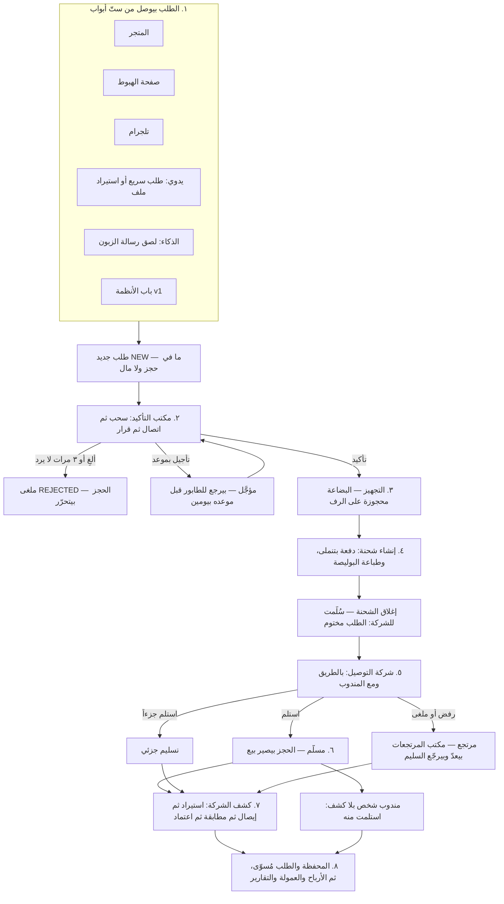
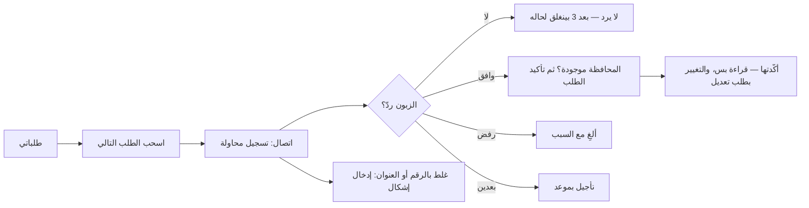
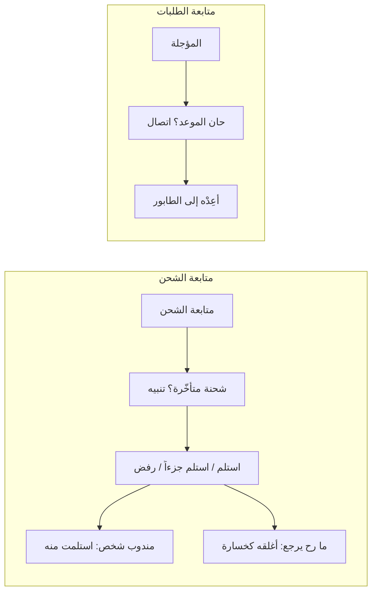
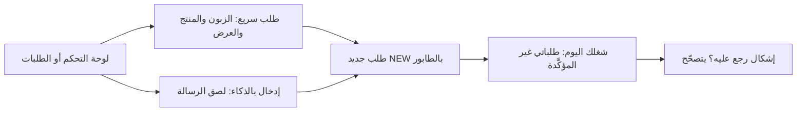
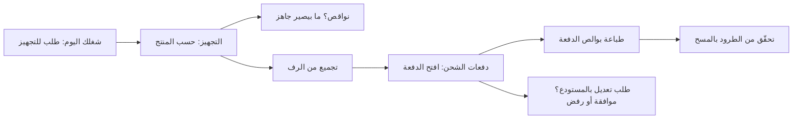
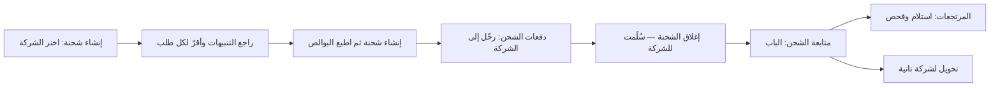
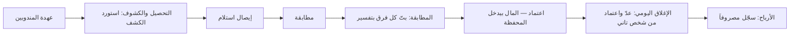
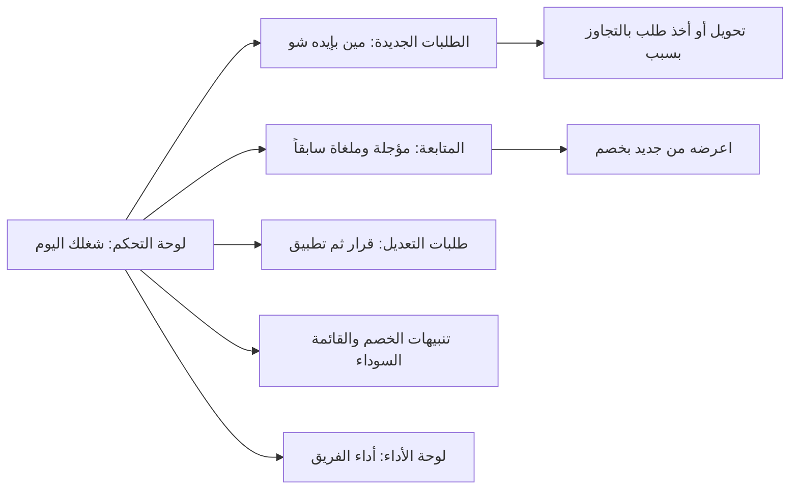
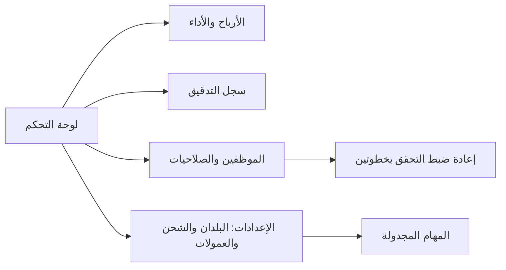

# شرح الموقع قسماً قسماً — للمبرمج الجديد

> **لمين؟** لمبرمج إنسان أول مرة بيفتح النظام. بيشرح كل قسم بالقائمة متل ما بيشوفه الموظف، وشو بيصير وراه بالكود.
> **المرجع:** `osm/main` عند `142708df` (30/10). قرأتُ الكود بس: لا بناء ولا تشغيل ولا تعديل.
> **السيناريوهات:** الأرقام متل «أ-01» و«د-17» هي سيناريوهات ملف `01-scenarios-by-role.md` بنفس المجلد. هون بس الرابط، والتفاصيل والأرقام هناك.
> **اختصارات المسارات:** `screens/X.tsx` = `src/components/screens/X.tsx` · الباب `POST /api/orders` = الملف `src/app/api/orders/route.ts` · `lib/X.ts` = `src/lib/X.ts`.
> النصوص العربية بين «» منسوخة من الكود. ما بكتب «بيشتغل» إلا لشي قرأته؛ الشي اللي ما تأكدت منه مكتوب جنبه **«يُتحقق»**.

---

## ٠. كيف بتنبني القائمة (اقرأ هاد أول)

| الشي | شو هو | الملف |
|---|---|---|
| سجل الشاشات | لستة وحدة لكل الشاشات: المسار والاسم والأيقونة والمفاتيح. شاشة مش بالسجل = 404 | `lib/route-registry.ts` (`NAV`) |
| الحارس | الصفحة بتسأل الخادم: معك أي مفتاح من مفاتيح الشاشة؟ لا ← 403. ما في متجر مختار ← `/entry` | `lib/page-guard.ts` (`guardRoute` · `requireShellContext`) |
| شكل المجموعة | `loose` = كل شاشة سطر لحالها · `tabs` = المجموعة سطر واحد وفوق كل شاشة شريط حبوب للباقي · `cards` = سطر واحد بيفتح صفحة بطاقات (الإعدادات) | `lib/route-registry.ts` (`GroupHub`) · `src/components/shell/HubTabs.tsx` |
| أرقام الطريق «1. 2. 3.» | الشحن (5 محطات) والمال (4 محطات) مرقّمين، وكل محطة بتقترح اللي بعدها | `lib/route-registry.ts` (`step`) · `lib/next-stop.ts` |
| شاشة مطوية | «لوحة الأداء» مش سطر بالقائمة لمين بيقدر يفتح لوحة التحكم (فيها رابط «التفاصيل») | `foldedUnder` بـ`lib/route-registry.ts` |
| شاشة خارج القائمة | «المساعد الذكي» بابه الفقاعة على كل شاشة | `offMenu` بـ`lib/route-registry.ts` |
| الدليل ⓘ | خطوات كل شاشة بأسماء أزرارها الحرفية | `lib/route-guide-texts.ts` |
| «شغلك اليوم» | بطاقات الشغل المنتظر حسب مفاتيحك (بانتظار التأكيد، طلب للتجهيز، كشف لم يُعتمد…) | `lib/my-work.ts` · `src/components/shell/MyWork.tsx` · `GET /api/me/work` |
| ترتيب القائمة الشخصي | كل موظف بيسحب ويخفي ويثبّت أسطره | `src/components/settings/MenuOrderCard.tsx` · `POST /api/nav/arrangement` · `lib/nav-arrangement.ts` |
| البحث السريع | `Ctrl+K` | `src/components/shell/CommandPalette.tsx` |
| إظهار الأزرار | الواجهة بتخفي الزر إذا ما معك المفتاح، بس **القرار للخادم** | `lib/can.ts` (`userCan`) · `lib/authorization.ts` |

**القاعدة الذهبية:** كل باب API بيسأل «مين أنت وشو بتقدر» من جديد (`src/lib/every-route-asks-who.test.ts`). إخفاء زر ما بيحمي شي.

**القائمة كاملة: 11 مجموعة، 52 شاشة** (`NAV` بـ`lib/route-registry.ts`): الرئيسية (4) · مركز التأكيد (4) · الشحن (5) · المخزون (3) · المال (7) · الرقابة (5) · النمو والذكاء (5) · المحادثات (2) · واجهة المتجر (2) · الإعدادات (12) · الإدارة (3).

---

## ١. منطق الشغل بكلام بسيط

النظام بيبيع **دفع عند الاستلام**: الزبون بيطلب، منتأكد منه بالتلفون، منجهّز ومنشحن، الشركة بتسلّم وبتقبض، وبعدين بتبعتلنا كشف ومنطابق ومنقبض منها.

| الخطوة | مين بيعملها (الدور · المفتاح) | الشاشة والباب | شو بيتغيّر بالمال | شو بيتغيّر بالمخزون |
|---|---|---|---|---|
| ١. الطلب بيوصل | الزبون (متجر/هبوط) · الموديريتور `orders.create` · النظام (تلجرام، v1) | `POST /api/public/stores/[store]/orders` و`POST /api/public/landing-pages/[slug]/orders` ← `lib/public-order.ts` · `POST /api/orders` · `POST /api/orders/import` · `POST /api/orders/ai-intake` · `POST /api/webhooks/telegram` ← `lib/telegram/order-creation.ts` · `POST /api/v1/orders` ← `lib/v1/order-intake.ts` | المطلوب من الزبون بيتحسب بمكان واحد `lib/money.ts`، بس ما في مال حقيقي | ولا شي: الطلب بيدخل `confirmationStatus: 'NEW'` (`src/app/api/orders/route.ts:633`) بلا حجز |
| ٢. التأكيد | موظفة تأكيد: `confirmation.pull` · `orders.contact_log` · `orders.confirm` | `/confirmation/mine` · `POST /api/confirmation/pull` · `POST /api/orders/[id]/contact-attempts` · `POST /api/orders/[id]/confirmation` | ما في مال. ممنوع تأكيد بلا محافظة لأن الأجرة مبنية عليها (`REGION_REQUIRED`) | التأكيد بيحجز كل سطر: المدفوع + الهدية + الإضافات (`reserveOrderLines` بـ`lib/reservation.ts`). الإلغاء بيحرّر بنفس المعاملة |
| ٣. التجهيز | موظفة تجهيز `ops.prepare` | `/ops/preparation` · `GET /api/ops/preparation` | — | قراءة بس: المطلوب والمتاح والنقص لكل منتج |
| ٤. الدفعة والبوليصة | شحن `ops.ship` · `ops.labels` · `ops.batches` | `/ops/shipments/new` · `POST /api/ops/shipments` · `/ops/batches` · `POST /api/ops/labels/printed` | بتتجمّد الأجرة ومبلغ التحصيل على الطلب (`deliveryFee` · `totalAmount`) وبيصير `settlementStatus: 'PENDING_COLLECTION'` (`src/app/api/ops/shipments/route.ts:389-398`) | لسا محجوز. الطباعة بتكتب `labelPrintedAt`: البضاعة «ملتزمة» وما بترجع متاحة (`lib/order-seal.ts`) |
| ٥. التسليم للشركة | شحن `ops.batches` | «إغلاق الشحنة — سُلّمت للشركة» = `PATCH /api/shipping-batches/[id]` بـ`status: 'SHIPPED'` | الطلب بيصير `SHIPPED` و**مختوم**: الاسم والعنوان والكمية والخصم والأجرة ما بتتعدّل إلا بطلب تعديل (`sealMessage` بـ`lib/order-seal.ts`) | — |
| ٦. الطريق | شركة الشحن نفسها | ويبهوك `POST /api/webhooks/couriers/[token]` ← `lib/couriers/apply-event.ts` · مهمة `sync-courier-status` (`src/lib/jobs/definitions/sync-courier-status.ts`) | — | — |
| ٧. الباب | متابعة/شحن `ops.deliver` | `/ops/tracking` · `POST /api/ops/tracking/deliver` (ALL · NONE · أسطر) | **ما بيكتب مال**؛ بيعرض «المتوقَّع تحصيله» بس (`doorMoney` بـ`lib/settlement.ts`) | تسليم كامل أو جزئي: `consumeOrderStock` بيحوّل الحجز لبيع من الدفعات (`lib/stock-consumption.ts`). رفض: ولا قطعة بترجع قبل عدّ المرتجعات (`POST /api/ops/returns` ← `restoreOrderStock`) |
| ٨. كشف الشركة | مالية `settlement.upload` · `settlement.review` · `settlement.approve` | `/finance/collection` · `/finance/matching` · `PATCH /api/finance/statements/[id]` (اعتماد) | الاعتماد بيكتب حركة داخلة للمحفظة لكل إيصال (`recordMovement` بـ`lib/wallets.ts`)، وبيكتب `collectedAmount` و`SETTLED` على الطلبات | طلب لسا «بالطريق» والكشف بيقول انسلّم: الاعتماد بيستهلك مخزونه |
| ٨ب. مندوب بلا كشف | مالية `finance.cashbox` | «استلمت منه» = `POST /api/ops/tracking/collect` | حركة داخلة للمحفظة + `SETTLED` | — |
| ٩. المحافظ والأرباح | محاسب · مالك | `/finance/wallets` · `/finance/transfers` · `/finance/closing` · `/finance/profit` | الإيراد من المسلَّم فعلاً. العمولة بمهمة `accrue-commission` بعد التسليم (`src/lib/jobs/definitions/accrue-commission.ts`). اقتراح خصومات الموظفين بمهمة `propose-penalties` | — |

**ثلاث حالات منفصلة على كل طلب:** `confirmationStatus` و`shippingStatus` و`settlementStatus`، والحالة «الأساسية» (14 حالة) بتنحسب منهم وما بتنخزن (`lib/order-state.ts`). المراحل الخمس اللي بتشوفها على بطاقة الطلب (الإدخال · التأكيد · التجهيز · الشحن · الإغلاق) بـ`lib/order-stages.ts`.

---

## ٢. الأقسام وحدة وحدة

### ٢.١ الرئيسية (أربع أسطر مفرودة)

#### `/dashboard` — لوحة التحكم
- **ليش:** صورة اليوم: «شغلك اليوم» ثم «ما يحتاج تدخّلاً» ثم أرقام الربح والإيراد ونسب التأكيد والتوصيل والإرجاع. **مين:** أي حدا معه `dashboard.view`.
- **الأزرار:** الفترة («اليوم» · «7 أيام» · «30 يوم» · «هذا الشهر» · «الكل») · «طلب سريع» (`orders.create`) · «إدخال بالذكاء الاصطناعي» · «التفاصيل» ← `/growth/performance`.
- **بالخلفية:** `GET /api/analytics` (بيطلب `reports.view` لحاله) · `GET /api/me/work`. الإدخال بالذكاء ← `POST /api/orders/ai-intake`، وهاد الباب **محلّي بس** (`localOnly`) لأن النص فيه اسم الزبون ورقمه؛ إذا المزوّد مش محلّي بيشتغل المحلّل العادي (`src/components/orders/AiOrderModal.tsx` · `AGENTS.md`).
- **رفض شائع:** معك `dashboard.view` بلا `reports.view`: الشاشة بتفتح والأرقام بتقول ما في صلاحية (`src/app/api/analytics/route.ts:9-16`).
- **الكود:** `screens/DashboardScreen.tsx` · **سيناريوهات:** هـ-01 · هـ-05.

#### `/orders` — الطلبات
- **ليش:** كل الطلبات، بحث وفلاتر وفتح الطلب. **مين:** `orders.view` بنطاق: كل الشركة / طلباته / المسندة إليه (`lib/permission-catalog.ts:45` · `orderVisibilityWhere` بـ`lib/rbac.ts:37`).
- **الأزرار:** بحث أو مسح بوليصة · الفلاتر (منها «متأخرة 10 أيام+ من الشحن») · «طباعة البوالص» (`ops.labels`) · «تصدير المحدَّد» (`reports.export`) · «استيراد طلبات» (`orders.import`) · نقل من نظام قديم (`orders.migrate`) · إنشاء طلب (`orders.create`) ومعه «الزبون على الخط — أكّده الآن» لمين معه `orders.confirm`.
- **بالخلفية:** `GET /api/orders` · `POST /api/orders` (طلب `NEW` + سطر سجل حالة + إشعار للمشرفين) · `POST /api/orders/import` · `POST /api/orders/import/migrate` · `GET /api/reports/export`.
- **رفض شائع:** `INVALID_PHONE` · `CUSTOMER_BLOCKED` «هذا الرقم محظور: …» · `IMPORT_NOT_ALLOWED` «لا تملك صلاحية استيراد الطلبات — الإدخال اليدوي متاح.» · `TOO_MANY_ROWS` · `MISSING_COLUMNS`.
- **الكود:** `screens/OrdersScreen.tsx` · `src/components/orders/CreateOrderModal.tsx` · **سيناريوهات:** ج-01…ج-13.

**نافذة الطلب** (بتنفتح فوق اللستة؛ الرابط `/orders/[id]` بيحوّل لـ`/orders?highlight=…`، `src/app/(system)/(shell)/orders/[id]/page.tsx`):
- **فيها:** «حالة الطلب» · المراحل الخمس · «الملخص المالي» (ما يدفعه العميل، الخصم، الأجرة) · «تكاليفنا على هذا الطلب» (بس مع `costs.view` و`finance.view`) · «جهة الطلب» (القناة) · الملاحظات (`orders.note`) · «سجل الأحداث» · «طلبٌ على هذا الطلب: تعديل · إلغاء · تأجيل» (`orders.request_change`).
- **بالخلفية:** `PATCH /api/orders/[id]` (التعديل، وتطبيق طلب تعديل بـ`changeRequestId`) · `POST /api/orders/[id]/claim` · `POST /api/orders/[id]/transfer` (`orders.assign`) · `POST /api/orders/[id]/notes` · `POST /api/orders/[id]/change-requests` · `POST /api/orders/[id]/shipping` (`orders.change_status`، والأجرة `orders.change_fee`) · `GET /api/orders/[id]/timeline`.
- **رفض شائع:** `VERSION_CONFLICT` «عدّل هذا الطلبَ شخصٌ آخر…» · `ORDER_LOCKED` «هذا الطلب يتم تعديله حالياً بواسطة …» · `CHANGE_REQUEST_REQUIRED` «الطلب مؤكَّد — التعديل بيصير بطلب تعديل.» · `ORDER_SEALED` · `USE_CONFIRMATION_DOOR` · `TRACKING_VIA_SHIPPING` «رقم التتبّع بيتغيّر من شاشة الشحن.» · `LINES_COMMITTED`.
- **الكود:** `src/components/orders/OrderDetailModal.tsx` · `src/app/api/orders/[id]/route.ts` · **سيناريوهات:** ب-01 · ب-09 · ب-23 · ج-04…ج-09 · هـ-02.

#### `/customers` — العملاء
- **ليش:** الزبون واحد على مستوى الشركة: رقم هاتف واحد = شخص واحد وتاريخ مخاطرة واحد. **مين:** `customers.view` أو `customers.view_basic` (الأساسي بس).
- **الأزرار:** بحث بالاسم أو الهاتف أو المحافظة · العدّادات (طلبوا · كرّروا · رفضوا طرداً · نسبة الاستلام) · فتح العميل وسجلّه · «إضافة عميل» (`customers.create`).
- **بالخلفية:** `GET/POST /api/customers` · `GET /api/customers/[id]/history` (`customers.view`).
- **الكود:** `screens/CustomersScreen.tsx` · **سيناريوهات:** ما في بملف 01.

#### `/products` و`/products/[id]` — المنتجات
- **ليش:** الكتالوج، الصور، السعر، العروض. **مين:** `products.view`؛ الإنشاء `products.create`، التعديل `products.edit`، السعر `products.change_price`، التكلفة الثابتة `products.change_cost` (مع `costs.view`)، الصور `products.upload_images`، العروض `offers.manage`.
- **الأزرار:** «إضافة منتج» · «تعديل المنتج» · الصور (الأولى رئيسية) · «التكلفة الثابتة» بصفحة المنتج (احفظ · ثبّت على المتوسط الحالي · امسح). البضاعة ما بتدخل من هون: من «تشغيلات الإنتاج» أو «استلام» بالأرصدة.
- **بالخلفية:** `GET/POST /api/products` · `PATCH/DELETE /api/products/[id]` · `POST /api/products/[id]/images` · `PUT /api/products/[id]/fixed-cost` (`products.change_cost`) · `GET/POST /api/offers` · `GET /api/products/[id]/stock` (`inventory.view`).
- **رفض شائع:** `COST_CHANGE_FORBIDDEN` «تغيير تكلفة المنتج ليس من صلاحيّاتك…» · `CATEGORY_REQUIRED` «اختر تصنيف المنتج…» · `BASE_BELOW_ACTIVE_OFFER` (سعر أساسي أقل من عرض فعّال، `src/app/api/products/[id]/route.ts:188-199`) · حذف منتج عليه طلبات: «لا يمكن حذف منتج مرتبط بطلبات — غيّر حالته إلى "غير نشط" بدلاً من الحذف».
- **الكود:** `screens/ProductsScreen.tsx` · `screens/ProductDetailScreen.tsx` · **سيناريوهات:** ج-01 · ج-03 (العروض).

### ٢.٢ مركز التأكيد (سطر واحد بحبوب)

#### `/confirmation/mine` — طلباتي (شاشة موظفة التأكيد)
- **ليش:** طاولة الموظفة. **مين:** `confirmation.work` أو `confirmation.pull`.
- **التبويبات:** «للشغل» · «لا يرد» · «أكّدتها» (قراءة بس) · «المؤجلة».
- **الأزرار:** «اسحب الطلب التالي» (فوق، `PullPanel`) · «اتصال» · «تأكيد الطلب» · «لا يرد» · «مغلق أو خارج التغطية» · «ألغِ» مع السبب · «تأجيل» بموعد · «افتح وعدّل» · «إدخال إشكال» (`confirmation.raise_issue`) · «أعِدْه إلى الطابور» · «طلب تعديل» على المؤكَّد.
- **بالخلفية:** `POST /api/confirmation/pull` (بيعطي المؤجَّل المستحق أول ثم الأقدم) · `GET /api/confirmation/mine` · `POST /api/orders/[id]/contact-attempts` · `POST /api/orders/[id]/confirmation` بأفعال `start` · `contact_result` · `confirm` · `reject` · `schedule_follow_up` · `cancel`. التأكيد بيحجز؛ الرفض والإلغاء بيحرّروا (`src/app/api/orders/[id]/confirmation/route.ts:379-383`). رفض «طلب وهميّ» بعد اتصال بيحظر الرقم تلقائياً.
- **حدود السحب:** 40 طلب بلا محاولة اتصال، و300 إجمالاً (`CLAIM_CAPS` بـ`lib/confirmation-queue.ts:18`). بعد 3 مرات «لا يرد» بينغلق لحاله بسبب `NO_ANSWER_3_ATTEMPTS`.
- **زبون راجع:** طلبه الجديد بينحجز للموظفة اللي اشتغلت مع زبونه قبل (آخر طلب سابق اشتغلت عليه، بنفس المتجر). بيظهر بقائمة «الطلبات» عند كل الموظفات مكتوب «تابع لـ(س)»، وهي لحالها بتسحبه، وبيطلع لها أول بـ«اسحب الطلب التالي». بيصير عاماً بعد 24 ساعة من وصوله، أو لما حسابها ما يكون فعّال. المشرف والمالك بيستلموه بـ«استلمه أنا». الكود: `lib/order-reservation.ts` (القاعدة والكلام) · `lib/reserve-returning-customers.ts` (الكاتب) · شغلة `reserve-returning-customers` كل دقيقتين.
- **رفض شائع:** `CONTACT_FIRST` «اتصل بالزبون أول — أو اكبس «لا يرد»» · `REGION_REQUIRED` «حدّد المحافظة أولاً — أجرة التوصيل مبنية عليها ولا يُؤكَّد طلب بلا محافظة» (`lib/confirmation-queue.ts:278,309`) · `INVALID_TRANSITION` · `ORDER_LOCKED` · `CONTACT_LOG_NOT_ALLOWED`.
- **الكود:** `screens/ConfirmationMineScreen.tsx` · `screens/confirmation/ActionDialogs.tsx` · `src/components/confirmation/PullPanel.tsx` · `lib/confirmation-workflow.ts` · **سيناريوهات:** أ-01…أ-24 · ب-01.

#### `/confirmation/queue` — الطلبات الجديدة (للمشرف)
- **ليش:** كم طلب منتظر، وكم بإيد كل موظفة، والصفوف نفسها. **مين:** `confirmation.supervise`. اللي ما معه هالمفتاح بيتحوّل لـ`/confirmation/mine` (`src/app/(system)/(shell)/confirmation/queue/page.tsx`).
- **بالخلفية:** `GET /api/confirmation/queue` · نفس زر السحب.
- **الكود:** `screens/ConfirmationQueueScreen.tsx` · **سيناريوهات:** أ-22 · ز-04.

#### `/confirmation/follow-up` — المتابعة (للمشرف)
- **ليش:** تبويبان: «مؤجلة» (وعد بالاتصال بموعد) و«ملغاة سابقاً» (استرجاع الزبون بخصم). **مين:** `confirmation.supervise`؛ العرض من جديد `confirmation.winback`؛ قاعدة الاسترجاع `offers.rules`.
- **الأزرار:** «أعِدْه إلى الطابور» · «اعرضه من جديد» بخصم ≤ «أقصى خصم» (بيعمل **طلب جديد** بيدخل الطابور العادي، والقديم بيضل ملغى).
- **بالخلفية:** `GET/POST /api/confirmation/postponed` · `GET/POST /api/confirmation/winback` · `PUT /api/confirmation/winback/rule`.
- **رفض شائع:** `NOT_DUE` «موعده لم يحن بعد — يعود إلى الطابور قبل موعده بـ2 يومين» · `ALREADY_IN_QUEUE` · `DISCOUNT_TOO_LARGE` «أقصى خصمٍ على هذا الطلب … — والمحسوم عليه سابقاً داخلٌ في الحساب».
- **الكود:** `screens/ConfirmationFollowUpScreen.tsx` · `screens/ConfirmationPostponedScreen.tsx` · `screens/WinbackScreen.tsx` · **سيناريوهات:** أ-11 (الإلغاء من المؤجّل).

#### `/confirmation/issues` — الإشكالات
- **ليش:** غلط من الموديريتور (رقم، عنوان، بيانات ناقصة) بترفعه موظفة التأكيد وبيتصحّح هون. **مين:** `confirmation.issues`؛ التصحيح `confirmation.issues_correct`؛ الإبطال `orders.cancel` («إبطال الطلب (المالك فقط)» مع «سبب الإبطال»).
- **بالخلفية:** `POST /api/confirmation/issues` (رفع) · `PATCH /api/confirmation/issues/[id]` (التصحيح بيمرّ بتعديل الطلب العادي نفسه).
- **رفض شائع:** `ISSUE_OPEN` «يوجد إشكال مفتوح على هذا الطلب» · `NOT_MODERATOR_ENTERED` · `ISSUE_CORRECT_FORBIDDEN`.
- **الكود:** `screens/ConfirmationIssuesScreen.tsx` · **سيناريوهات:** ما في بملف 01.

### ٢.٣ الشحن — طريق الطرد بخمس محطات

#### 1. `/ops/preparation` — التجهيز
- **ليش:** الطلبات المؤكدة مجمّعة حسب المنتج، مع «طلبات» و«نواقص». **مين:** `ops.prepare`.
- **الأزرار:** فتح المنتج · «افتح الطلب» · «ألغِ الطلب» (`orders.cancel`). طلب عليه «طلب تعديل بانتظار البتّ» لا تغلّفه.
- **بالخلفية:** `GET /api/ops/preparation` · الإلغاء ← `POST /api/orders/[id]/confirmation` (`cancel`) · مساعد التجميع `POST /api/ai/picking`.
- **الكود:** `screens/PreparationScreen.tsx` · `screens/ops/PickingAssistant.tsx` · **سيناريوهات:** د-19 · أ-18 · أ-19.

#### 2. `/ops/shipments/new` — إنشاء شحنة
- **ليش:** نحط الطلبات الجاهزة على عربة شركة. **مين:** `ops.ship`.
- **الأزرار:** «شركة الشحن (للشحنة)» · فلتر المحافظة والتاريخ · «أقرّ بالتنبيه وأتابع» (لكل طلب لحاله) · «الكل» · «إنشاء شحنة» · «اطبع البوالص».
- **بالخلفية:** `POST /api/ops/shipments` — بيلاقي دفعة مفتوحة للشركة أو بيعمل وحدة (`status: 'READY'`)، وبيكتب على كل طلب الدفعة والأجرة ومبلغ التحصيل و`READY_FOR_PICKUP` و`PENDING_COLLECTION` · تأجيل الشحن `POST /api/ops/shipments/hold` · إلغاء من العربة `POST /api/ops/shipments/stand-down`.
- **رفض شائع:** `UNRESERVED_LINES` («لا يمكن التجهيز: 1 سطر غير محجوز بالكامل») · `ALL_BLOCKED` «لا يوجد طلب صالح للشحن ضمن الاختيار» · `ORDER_MOVED_ON` · `HOLD_TOO_LONG` (أقصى 30 يوم، `MAX_HOLD_DAYS`).
- **الكود:** `screens/ShipmentsNewScreen.tsx` · `src/app/api/ops/shipments/route.ts` · **سيناريوهات:** د-09…د-14 · د-18 · أ-18 · أ-19.

#### 3. `/ops/batches` — دفعات الشحن
- **ليش:** للدفعة ثلاث حالات بس: تُملأ (`READY`) ← سُلّمت للشركة (`SHIPPED`) ← تنتهي بعد التسوية (`CLOSED`). **مين:** `ops.batches`؛ التعديل جوّا الدفعة `ops.edit_in_batch` (ما بيُعطى لحدا افتراضياً)؛ البتّ بتعديل والطلب بالمستودع `ops.decide_changes`.
- **الأزرار:** «طباعة بوالص الدفعة» · ملف الشركة CSV · «تحقّق من الطرود» (مسح) · «رحّل إلى الشركة واجلب الباركود» · «إغلاق الشحنة — سُلّمت للشركة» · «أنهِ الدفعة بعد التسوية» · قلم «عدّل» على الطرد.
- **بالخلفية:** `GET/PATCH /api/shipping-batches/[id]` · `POST /api/ops/shipments/[id]/dispatch` · `GET /api/ops/labels/print` + `POST /api/ops/labels/printed` · التعديل `PATCH /api/orders/[id]` (منطق `lib/prep-edit.ts`).
- **رفض شائع:** `PENDING_CHANGES` (طرد عليه إلغاء أو تأجيل ما انجاوب) · `EMPTY_BATCH` · `MEMBERS_MOVED` «تغيّر طرد من الدفعة أثناء الضغط…» · `BATCH_NOT_READY` · `ORDER_SEALED` · `CHANGE_REQUEST_REQUIRED` · `PREP_REGION_FEE`.
- **الكود:** `screens/ShippingBatchesScreen.tsx` · `src/app/api/shipping-batches/[id]/route.ts` · **سيناريوهات:** د-01…د-08 · د-16.

#### 4. `/ops/tracking` — متابعة الشحن
- **ليش:** شو صار عند الباب. الحالة الافتراضية «قيد الشحن وبانتظار التحصيل». **مين:** `ops.track`؛ والأفعال كل واحد بمفتاحه: `ops.deliver` · `finance.cashbox` («استلمت منه») · `ops.write_off` · `ops.transfer`.
- **الأزرار:** «استلم» · «رفض / ملغى» · «استلم جزءاً» · «استلمت منه» (لمندوب شخص) · «أغلقه كخسارة» · «تحويل».
- **بالخلفية:** `POST /api/ops/tracking/deliver` (بيستهلك المخزون، ما بيكتب مال) · `POST /api/ops/tracking/collect` (حركة محفظة + `SETTLED`) · `POST /api/ops/tracking/write-off` (بيخرّج البضاعة نهائياً) · `POST /api/ops/tracking/transfer` (قبل التسليم: نفس الطلب على عربة الشركة الجديدة؛ بعده: طلب بديل، `lib/couriers/transfer.ts` · `lib/order-cancel.ts`).
- **رفض شائع:** `NOT_DELIVERED` · `MIXED_COURIER` · `MIXED_CURRENCY` · `WALLET_CURRENCY_MISMATCH` · `ALREADY_SETTLED` · `NOT_AWAITING_RETURN` · `NO_OPEN_BATCH` «لا توجد دفعة مفتوحة لـ… افتح دفعة لها أولاً» · `ALREADY_REPLACED`.
- **الكود:** `screens/TrackingScreen.tsx` · `screens/tracking/DeliverDialog.tsx` · `CollectDialog.tsx` · `WriteOffDialog.tsx` · `TransferDialog.tsx` · `lib/partial-delivery.ts` · **سيناريوهات:** د-17 · و-05 · و-12.

#### 5. `/ops/returns` — المرتجعات
- **ليش:** الطرد الراجع بيتعدّ ويتفحص قبل ما يرجع للرف. **مين:** `ops.returns`؛ أجرة الإرجاع على الشركة `ops.return_fee`.
- **الأزرار:** مسح البوليصة أو المرجع · «استلام» · بنافذة «استلام مرتجع»: «سليم» أو «تالف» لكل بند · الإقرار بالعدّ.
- **بالخلفية:** `POST /api/ops/returns` — السليم بيرجع للرف (`restoreOrderStock`)، التالف بيتسجّل، الناقص بيحسبه الخادم، والطلب `RETURNED`. بالتسليم الجزئي الطلب بينغلق على مرّتين: نص للمستلَم (بالكشف) ونص للراجع (هون).
- **رفض شائع:** `ALREADY_RECEIVED` «تم استلام هذا المرتجع مسبقاً» · `OVER_RECEIVED` · `DELIVERED_AND_SETTLED` · `RETURN_FEE_FORBIDDEN`.
- **الكود:** `screens/ReturnsScreen.tsx` · `src/app/api/ops/returns/route.ts` · **سيناريوهات:** ما في بملف 01 (القسم «غير مغطّى»).

### ٢.٤ المخزون

| المسار | الهدف | المفتاح | الأزرار | الباب ← شو بيتغيّر | رفض شائع | الملف |
|---|---|---|---|---|---|---|
| `/inventory/balances` | لكل منتج «على الرف» و«محجوز» و«متاح» و«تكفي (يوم)» | `inventory.view`؛ الاستلام والجرد `inventory.adjust` | «استلام» (بضاعة جاهزة بكلفتها) · «جرد مخزون» ← «سجّل الجرد» | `POST /api/inventory` ← دفعة جديدة بكلفتها أو حركة جرد بفرق وسبب · `POST /api/inventory/opening-count` | `WRONG_DOOR` «… منتج مصنّع — تُضاف كميته من تشغيلات الإنتاج…» · `UNIT_COST_REQUIRED` | `screens/InventoryBalancesScreen.tsx` |
| `/manufacturing` | تشغيلة إنتاج بكلفة مفصّلة | `production.view`؛ الحفظ `production.manage` | «تشغيلة جديدة» · بنود الكلفة · «احفظ الدفعة وأضفها للمخزون» | `POST /api/production` ← دفعة + حركة دخول بكلفة الوحدة | `WRONG_DOOR` (منتج مشترى جاهز) | `screens/ManufacturingScreen.tsx` |
| `/inventory/movements` | كل حركة حرّكت رصيد | `inventory.view` | بحث و«النوع» | `GET /api/inventory/movements` — قراءة بس؛ الغلط بيتصحّح بحركة عكسية | — | `screens/InventoryMovementsScreen.tsx` |

**قاعدتين:** المخزون للمتجر مش للشركة (`lib/reservation.ts`)، والوحدات عايشة بالدفعات: حركة ما بتحرّك دفعة ما بتحرّك شي (`lib/stock-consumption.ts`). **سيناريوهات:** أ-18 · أ-19 · د-17 · و-16.

### ٢.٥ المال — طريق مال المندوب (4 محطات) + 3 شاشات

#### 1. `/finance/agents` — عهدة المندوبين
- **ليش:** شو بإيد كل مندوب: «ما زال بيده» (بضاعة) · «حصّله ولم يسلّمه» · «سُلّمت ولا مبلغ مؤكَّد». **مين:** `settlement.view` أو `settlement.review`. **قراءة بس** — التحصيل من «متابعة الشحن».
- **الباب:** `GET /api/finance/agents` · **الكود:** `screens/AgentCustodyScreen.tsx`.

#### 2. `/finance/collection` — التحصيل والكشوف
- **ليش:** كشف الشركة: استيراد ← إيصال ← مطابقة ← تفسير الفرق ← اعتماد. **مين:** `settlement.upload` أو `settlement.view`؛ الاعتماد `settlement.approve`.
- **الأزرار:** «شركة الشحن» + «مرجع الكشف» + «ملف الكشف (Excel أو CSV)» · «إيصال استلام» (محفظة ومبلغ؛ أكتر من إيصال مسموح) · «مطابقة» · «تفسير الفرق» ← «حفظ التفسير» · «اعتماد» · «تجميع» (للمسوّدة اليدوية).
- **بالخلفية:** `POST /api/finance/statements` · `POST /api/finance/statements/[id]/receipts` · `POST .../match` · `PATCH /api/finance/statements/[id]` (اعتماد: حركة IN لكل إيصال، `SETTLED`، `collectedAmount`، `STATEMENT_APPROVED` بالتدقيق) · `POST /api/finance/statements/manual` · `POST .../assemble`.
- **رفض شائع:** `DUPLICATE_STATEMENT` · `UNREADABLE_FILE` · `RECEIPT_EXISTS` · `EXCHANGE_RATE_REQUIRED` · `RECEIPT_REQUIRED` «سجّل إيصال الاستلام أولاً — المطابقة تأتي بعده» · `ALREADY_APPROVED` «الكشف معتمد مسبقاً» · `POSSIBLE_DOUBLE` (حركة يدوية بنفس المبلغ) · `ORDERS_CHANGED` · `SHORTFALL_UNNAMED`.
- **الكود:** `screens/finance/CollectionScreen.tsx` · `src/app/api/finance/statements/[id]/route.ts` · `lib/settlement.ts` · **سيناريوهات:** و-01 · و-02 · و-06 · و-07 · و-09 · و-15.

#### 3. `/finance/matching` — المطابقة
- **ليش:** أربع مجموعات: «مطابق» · «فرق في المبلغ» · «في الكشف وليس عندنا» · «طلبات لم يذكرها أي كشف». وتبويب «يدوي — بلا كشف». **مين:** `settlement.review`.
- **الأزرار:** اختيار «الكشف» · البتّ (رقم الشركة / رقمنا / «قيد المراجعة») بتفسير 5 أحرف على الأقل · «بتّ جماعي» · «ربطه بطلب» · «كان من طرد طلب آخر» · باليدوي: «تم تسليمها» · «رجعت» · «استلمت منه» · «مطابق يدوي».
- **بالخلفية:** `POST .../decisions` · `POST .../matches/[matchId]/resolve` · `.../link` · `.../swap` · `.../order-action` · اليدوي ← `POST /api/ops/tracking/deliver` و`POST /api/ops/tracking/collect`. المطابقة بمرجع التاجر ثم باركود الشركة، **أبداً بالهاتف**.
- **رفض شائع:** `DECISION_NOT_ALLOWED` «لا يصحّ هذا البتّ على … سطراً — لم يُحفظ شيء.» · `NO_DOOR_TO_CORRECT_STATUS` · `NUMBER_CLASH`.
- **الكود:** `screens/finance/MatchingScreen.tsx` · `screens/finance/ManualMatching.tsx` · **سيناريوهات:** و-06 · و-08 · و-10 · و-11 · و-15.

#### 4. `/finance/closing` — الإغلاق اليومي
- **ليش:** لكل محفظة «رصيد الدفاتر» مقابل «المبلغ المعدود فعلياً». **مين:** `finance.cashbox_view`؛ العدّ `finance.cashbox`؛ الاعتماد `finance.closing_approve` ومن **شخص تاني**.
- **الباب:** `POST /api/finance/closing` (العدّ) · `PATCH /api/finance/closing` (الاعتماد).
- **رفض شائع:** `EXPLANATION_REQUIRED` «الفرق … يحتاج تفسيراً مكتوباً» · `PREVIOUS_CLOSING_UNEXPLAINED` · `SEGREGATION_OF_DUTIES` «من يسجّل الحركات أو الجرد لا يعتمد الإغلاق — يعتمده شخص آخر» · `CLOSING_OUT_OF_DATE`.
- **الكود:** `screens/finance/ClosingScreen.tsx` · **سيناريوهات:** و-14.

| المسار | الهدف | المفتاح | الباب ← شو بيتغيّر | رفض شائع | الملف · سيناريو |
|---|---|---|---|---|---|
| `/finance/wallets` | المحافظ وحركاتها. ولا حركة بتنحذف: «قيد عكسي» بسبب | `finance.cashbox_view`؛ حركة `finance.cashbox`؛ إنشاء وتعديل محفظة `finance.wallets_manage` | `POST /api/finance/wallets` · `POST/PATCH /api/finance/wallets/[id]/movements` (حركة / عكس) · `POST .../opening-count` | `NAME_TAKEN` «يوجد محفظة بنفس الاسم في هذا المتجر» · `STORE_REQUIRED` | `screens/finance/WalletsScreen.tsx` · `lib/wallets.ts` · و-04 · و-13 · و-14 |
| `/finance/transfers` | نقل بين محفظتين (بسعر صرف محفوظ) | `finance.cashbox_view`؛ التسجيل `finance.cashbox` | `POST /api/finance/transfers` ← حركتين بمعاملة وحدة | `EXCHANGE_RATE_REQUIRED` · `EXCHANGE_RATE_TOO_SMALL` · `KIND_CHANGED` | `screens/finance/TransfersScreen.tsx` · و-14 |
| `/finance/profit` | «إيراد الموصَّل» − الكلفة − الشحن والعمولات − المصاريف = «الصافي» | `finance.view`؛ مصروف `finance.create`؛ إلغاؤه `finance.update`؛ الكلفة بتختفي بلا `costs.view` | `GET /api/finance/profitability` · `POST /api/finance` (مصروف من محفظة) · `PATCH /api/finance` · `PATCH /api/orders/[id]/finance` | `SETTLE_THROUGH_COLLECTION` (ممنوع تسوية يدوية بلا مال داخل) · `UNKNOWN_CATEGORY` | `screens/FinanceProfitScreen.tsx` · `lib/financial.ts` · و-03 · و-13 · و-16 |

### ٢.٦ الرقابة

| المسار | الهدف | المفتاح | الأزرار | الباب ← شو بيتغيّر | رفض شائع | الملف · سيناريو |
|---|---|---|---|---|---|---|
| `/control/change-requests` | طلبات التعديل: «بانتظار القرار» و«بانتظار التطبيق» | `control.change_requests`؛ القراءة `control.change_requests_view`؛ المال (سعر/كمية/منتج) `orders.change_price` | «مراجعة واتخاذ القرار» · «موافقة» · «رفض» · «طبّق التعديل» | القرار `PATCH /api/control/change-requests/[id]` · المعاينة `GET .../preview` · التطبيق `PATCH /api/orders/[id]` بـ`changeRequestId` (القيم من الخادم مش الشاشة) · الإلغاء ينفّذ بـ`POST /api/ops/shipments/stand-down` والتأجيل بـ`.../hold` | `SELF_APPROVAL` «لا يمكنك اعتماد طلب تعديل قدّمته بنفسك» · `ALREADY_DECIDED` «تم البت في هذا الطلب مسبقاً» · `PRICE_KEY_REQUIRED` · `STOCK_SHORT` | `screens/ChangeRequestsScreen.tsx` · `lib/change-request-*.ts` · ب-01…ب-24 |
| `/control/discount-alerts` | مين بيخصم كتير ولمين | `control.discount_alerts` | «المدة» · «حسب الموظف» | `GET /api/control/discount-alerts` — قراءة بس | — | `screens/DiscountAlertsScreen.tsx` |
| `/control/penalties` | خصومات الموظفين المقترحة و«فرق تحصيل» | `penalties.view`؛ القرار `penalties.decide` | «اعتمد الخصم» (صف صف) · «ألغِ» بسبب · «ارتجاع» · «حوّل لموظف آخر» | `GET/POST /api/team/penalties` · الاقتراح من مهمة `propose-penalties` | — | `screens/PenaltiesScreen.tsx` · و-09 |
| `/control/audit` | سجل كل تعديل على طلب أو مال أو صلاحية | `audit.view` | بحث · «مَن» · «على ماذا» · المدة · «افتح» | `GET /api/audit-logs` — ولا شي بينحذف | — | `screens/AuditScreen.tsx` · كل سيناريو |
| `/control/blacklist` | حظر رقم هاتف على كل الشركة | `control.blacklist`؛ الحظر والفك `control.blacklist_manage` | «حظر رقم» · «فك الحظر» بسبب · «أظهر المفكوكين» | `GET/POST/PATCH /api/control/blacklist` | `ALREADY_BLOCKED` | `screens/BlacklistScreen.tsx` · أ-08 |

**مين بيبتّ بطلب التعديل؟** حسب وين الطلب (`lib/change-request-routing.ts`): قبل التأكيد = الموظفة اللي ماسكته · مؤكَّد وبالمستودع = المستودع (`ops.decide_changes`) · بعد «سُلّمت للشركة» = المشرف بس. المشرف بيقدر دايماً، وما حدا بيبتّ بطلبه.

### ٢.٧ النمو والذكاء

| المسار | الهدف | المفتاح | الباب | الملف |
|---|---|---|---|---|
| `/growth/performance` (مطوية تحت اللوحة) | ربح كل منتج، الترتيبات، أداء الموظفين والقنوات والشركات · «تصدير CSV» | `reports.view`؛ الفريق `team.monitor` | `GET /api/analytics/performance` · `GET /api/orders/confirmation/team` · `GET /api/orders/shipping/performance` · `GET /api/growth/attribution` | `screens/PerformanceScreen.tsx` |
| `/growth/campaigns` | حملة: اسم ومنصّة ووجهة ومنتج وإنفاق؛ «رابط الإعلان» بيربط الطلبات بالحملة · «اسحب الإنفاق» | `campaigns.view`؛ التعديل `campaigns.manage` | `GET/POST /api/growth/campaigns` · `.../sync` · `.../import` · `.../bulk` | `screens/CampaignsScreen.tsx` |
| `/assistant` (خارج القائمة) | الدردشة نفسها اللي بالفقاعة، مفتوحة كاملة | `ai.use` | `POST /api/ai/chat` · `GET/POST /api/ai/daily-summary` | `screens/AssistantScreen.tsx` |
| `/growth/intelligence` | اكتشافات بتسمّي مشكلة ورقمها وشو تعمل | `growth.intelligence`؛ السؤال `ai.use` | `GET /api/growth/intelligence` · `POST .../ask` | `screens/IntelligenceScreen.tsx` |
| `/growth/bench` | «منصّة التجريب»: منتجات تجريبية، أرقامها **برّا** كل حسبة تانية | `growth.intelligence` | `GET /api/growth/bench` | `screens/BenchScreen.tsx` |

ما في سيناريوهات لهالقسم بملف 01.

### ٢.٨ المحادثات

| المسار | الهدف | المفتاح | الأزرار | الباب | الملف |
|---|---|---|---|---|---|
| `/growth/whatsapp/inbox` | صندوق واتساب واحد مشترك على رقم واحد | `whatsapp.view`؛ الإرسال `whatsapp.send`؛ الإسناد `whatsapp.assign` | اختيار محادثة · «مُسندة إلى:» · «لوحة العميل» · «اكتب رسالة...» · «إعادة الإرسال» | `GET /api/whatsapp/conversations` · `POST .../[id]/messages` · `.../assign` · الوارد `POST /api/webhooks/whatsapp` | `screens/WhatsAppInboxScreen.tsx` |
| `/growth/telegram/orders` | رسائل مجموعات تلجرام اللي بتصير طلبات | `telegram.view`؛ الإعادة والتجاهل والتصحيح `telegram.manage` | «إعادة المعالجة» · «تجاهل» · التصحيح | `GET /api/telegram/messages` · `POST .../[id]/retry` · `.../ignore` · `.../correct` · الوارد `POST /api/webhooks/telegram` ← `lib/telegram/inbound.ts` | `screens/TelegramOrdersScreen.tsx` · `screens/TelegramCorrectDialog.tsx` · `docs/telegram.md` |

**تلجرام بكلمتين:** الرسالة بتسع عناوين («إسم العميل» · «رقم الهاتف» · «إسم العرض» · «السعر» · «الكمية»…) بتصير طلب `NEW`. رسالة مش بالصيغة ← «متجاهلة». بالصيغة وفيها غلط ← «للمراجعة» والسبب بيسمّي الحقل، **وما بيصير طلب** (ما في رقم ولا حجز، `lib/order-state.ts` فقرة `NEEDS_REVIEW`).

### ٢.٩ واجهة المتجر (شغل وكيل تاني)

> **تنبيه:** `src/app/s/**` · `src/app/lp/**` · `src/components/storefront/**` · `src/components/landing*/**` · `src/components/store/**` وشاشات `/store/*` ومكتبات المتجر والهبوط **إلها فرعها ووكيلها** — ما بتنلمس من برّا (`AGENTS.md`، «Who owns what»).

| المسار | الهدف | المفتاح | الباب | الملف |
|---|---|---|---|---|
| `/store` | كل المتاجر ببطاقات، وثلاث تبويبات: «الواجهة» (الصفحة الرئيسية، القالب والألوان) · «المحتوى» (الصفحات والسياسات، الآراء، القوائم، البحث والفلاتر، اللغة) · «العنوان» (الدومين، المسارات) | `storefront.view` أو `storefront.manage` أو `geo.manage`؛ النشر `storefront.publish`؛ الدومين `storefront.domain` | `/api/store/design` · `/theme` · `/templates` · `/pages` · `/menus` · `/search` · `/language` · `/domain` · `/redirects` · `/api/reviews` | `src/components/store-admin/StoreAdminScreen.tsx` · `lib/store-admin.ts` |
| `/store/landing-pages` وتفاصيلها ومحرّرها | صفحة هبوط لمنتج: «صفحة جديدة» بخطوات (المنتج · الشكل · المظهر)، «اكتب النصوص بالذكاء الاصطناعي»، نسخ، حذف، نشر، دومين خاص، ملف HTML، «نموذج الطلب»، «المنتجات المقترحة بعد الطلب» | `landing_pages.view`؛ `.create` · `.edit` · `.publish` · `.delete` | `GET/POST /api/landing-pages` · `PATCH/DELETE /api/landing-pages/[id]` · `.../duplicate` · `.../content` · `.../domain` · `POST /api/ai/landing-copy` | `screens/LandingPagesScreen.tsx` · `LandingPageDetailScreen.tsx` · `LandingPageEditorScreen.tsx` |

**الطلب من المتجر أو الهبوط:** بيمرّ بـ`lib/public-order.ts`: نفس البلد ونفس القائمة السوداء (رفض محايد «تعذر إرسال الطلب، يرجى التواصل معنا»، `lib/blacklist.ts:70`) ونفس حارس التكرار (رقم واحد مرة كل 5 دقايق لكل باب، `lib/public-order.ts:425`). بعد الطلب في عرض «بعد الطلب» (`POST /api/public/orders/[orderNumber]/post-order-offer`) بيضيف للطلب نفسه.

### ٢.١٠ الإعدادات (سطر واحد بيفتح بطاقات)

`/settings` بيفتح 8 بطاقات (`lib/settings-home.ts`): البلدان والمتاجر · الشحن · العمولات · القنوات والتتبّع · واتساب وتلجرام · الذكاء الاصطناعي · التطبيقات · النظام. بطاقة ما معك ولا شاشة منها ما بتنرسم.

| المسار | الهدف | المفتاح | الباب ← شو بيتغيّر | رفض شائع · سيناريو | الملف |
|---|---|---|---|---|---|
| `/settings/geo` | بلد: عملة، منطقة زمنية، دوام، بادئة رقم الطلب، محافظات، «السعر المُعلن يشمل التوصيل»، `allowNegativeStock`. المتجر بيورث من بلده | `geo.view`؛ التعديل `geo.manage` | `/api/geo/countries` · `/api/geo/countries/[id]/regions` · `/api/geo/stores` | العملة بتنقفل بعد أول طلب · ز-03 · أ-18 · أ-19 | `screens/GeoSettingsScreen.tsx` |
| `/settings/couriers` | شركة شحن أو مندوب، وأجور كل محافظة، و«الحساب والتكامل» | `settings.view`؛ الحفظ `settings.edit`؛ الأجور `settings.delivery_fees` | `/api/delivery-providers` · `PUT /api/settings/delivery-fees` | `CODE_TAKEN` · `STORE_REQUIRED` · `REASON_REQUIRED` · شركة بلا أجور ما بتشحن | `screens/CouriersScreen.tsx` · `src/lib/couriers/README.md` |
| `/settings/commission` | قواعد العمولة بشرائح وتاريخ سريان؛ ما بتتعدّل، بتنتهي وبتنعمل غيرها | `commission.view`؛ `commission.manage`؛ الصرف `finance.create` | `/api/settings/commission` · `/api/finance/commission/payout` · `/progress` | — | `screens/CommissionSettingsScreen.tsx` · `lib/commission*.ts` |
| `/settings/channels` | قنوات الطلبات (صفحة بعينها على منصّة) و«سكور القنوات» | `settings.view`؛ `settings.edit` | `/api/settings/channels` | القناة المستعملة بتتعطّل ما بتنحذف | `screens/ChannelsScreen.tsx` |
| `/settings/tracking` | بكسلات الإعلانات، التحويلات المخصّصة، حسابات الإعلانات | `settings.view`؛ `settings.tracking` | `/api/settings/tracking-pixels` · `/conversions` · `/ad-accounts` | — | `src/app/(system)/(shell)/settings/tracking/page.tsx` |
| `/settings/links` | بطاقتا «واتساب» و«تلجرام» (المفاتيح بمتغيّرات بيئة الخادم، **مش** بالشاشة) | `whatsapp.manage` أو `telegram.manage` | `/api/whatsapp/connection/*` · `/api/telegram/status` · `POST /api/telegram/webhook/setup` | — | `screens/LinksSettingsScreen.tsx` |
| `/settings/ai` | المزوّد والمفتاح (أو «عنوان الخادم» للمحلّي)، النصوص، قوالب رسائل الزبائن | `settings.view`؛ `settings.manage` | `/api/settings/ai` · `/api/settings/ai/test` | `ENCRYPTION_UNAVAILABLE` · `ENDPOINT_REQUIRED` | `screens/AiSettingsScreen.tsx` · `lib/ai-provider/` |
| `/apps/store` و`/apps/installed` | تكاملات جاهزة، تسجيل تطبيق خارجي («سرّ التوقيع» بيظهر مرة وحدة)، «سجل الإرسال» | `apps.view`؛ `apps.manage`؛ رموز الأنظمة `apps.tokens` | `/api/apps` · `/api/apps/installs` · `/api/apps/deliveries` · `/api/settings/system-tokens` | `ENCRYPTION_KEY_MISSING` | `screens/AppStoreScreen.tsx` · `InstalledAppsScreen.tsx` · `src/lib/apps/events.ts` |
| `/settings/system` | «اسم الشركة» وقوالب الرسائل | `settings.view`؛ `settings.edit` | `PATCH /api/settings` | — | `screens/SystemSettingsScreen.tsx` |
| `/admin/jobs` | المهام المجدولة: «آخر نجاح:» · «شغّلها الآن» · «شغّلها كلَّها بالترتيب» | `settings.view`؛ التشغيل `settings.jobs` | `GET/POST /api/admin/jobs` | `ALREADY_RUNNING` · `JOB_FAILED` | `screens/JobsScreen.tsx` · `src/lib/jobs/` |

### ٢.١١ الإدارة

| المسار | الهدف | المفتاح | الأزرار | الباب | رفض شائع · سيناريو | الملف |
|---|---|---|---|---|---|---|
| `/admin/users` و`/admin/users/[id]` | الموظفين، طلبات التسجيل، الدور والصلاحيات والوصول، الوردية، الراتب | `users.view`؛ `users.create` · `users.edit` · `users.security` · `users.shift` · `payroll.pay` | «موظف جديد» · «إدارة» ← «اعتماد الحساب» · «إيقاف مؤقت» · «تعطيل» · «تنشيط الحساب» | `POST /api/users` · `PATCH /api/users/[id]` · `/api/users/[id]/permissions` (`roles.edit`) · `DELETE /api/users/[id]/two-factor` (`users.security`) · `/api/payroll/payslip` | `SUPER_ADMIN_ONLY` · `OWN_SHIFT` · و-09 | `screens/UsersScreen.tsx` · `UserDetailScreen.tsx` |
| `/admin/permissions` | الأدوار: نظامية (إلها افتراضي) ودور شركة؛ نطاق لكل صلاحية | `roles.view`؛ `roles.create` · `roles.edit` · `roles.edit_system` · `roles.delete` | «دور جديد» · «إرجاع للافتراضي» · «نسخ» · «حذف» ← «دورًا بديلًا» | `/api/roles` · `/api/roles/[id]` · `/default` · `/duplicate` | `STALE_VERSION` · `ORPHAN_ACTION` (إجراء بلا شاشته) · ز-01 · ز-02 | `screens/PermissionsScreen.tsx` · `lib/permission-catalog.ts` |
| `/admin/profile` | اسمي وكلمة سري و«ترتيب القائمة» | لكل حساب فعّال (بلا مفتاح) | «حفظ التغييرات» | `/api/profile` · `/api/nav/arrangement` | — | `screens/ProfileScreen.tsx` |

**الدخول:** `/login` · `/register` (بينتظر اعتماد ← `/pending`) · `/forgot-password` · `/entry` (اختيار البلد والمتجر) · `/no-access` (ما في ولا شاشة). كل حساب بيسجّل التحقق بخطوتين أول دخول (`01b-test-data-setup.md`).

---

## ٣. يوم عمل كل دور

> المفاتيح الكاملة لكل دور بملف 01 (قسم «الأدوار: الشاشات والمفاتيح»). قوالب الأدوار جاية من **قاعدة البيانات** مش من الكود؛ تأكد منها بـ«الصلاحيات».

### ١) موظفة تأكيد

بتشتغل كل اليوم بشاشة وحدة. بتسحب لحد 40 طلب بلا محاولة (300 إجمالاً). **سيناريوهات:** أ-01…أ-24.

### ٢) موظفة متابعة (معنيين)

**سيناريوهات:** د-17 · و-05 · و-12 · أ-11.

### ٣) موديريتور / مدخل طلبات

ما بيأكّد (إلا مع `orders.confirm` و«أكّده الآن»)، وما بيشوف إلا طلباته (نطاق `OWN`). **سيناريوهات:** ج-01…ج-13.

### ٤) موظفة تجهيز

**سيناريوهات:** د-01…د-07 · د-19 · ب-14 · ب-20.

### ٥) مسؤول الشحن

**سيناريوهات:** د-09…د-18 · و-12.

### ٦) محاسب / مالية

**سيناريوهات:** و-01…و-16.

### ٧) مشرف

**سيناريوهات:** ب-02 · ب-03 · ب-08 · ب-09 · ب-13 · ب-14 · ب-16 · ب-20 · ب-21 · أ-03 · ز-04.

### ٨) مالك

**سيناريوهات:** ز-01…ز-04 · هـ-04. **النشر مش من هون:** الدمج مش نشر، والنشر ضغطة «Redeploy» من المالك وحده (`AGENTS.md`).

---

## ٤. سيناريوهات حدّية مهمة (شو بيصير لو…)

| القسم | شو بيصير لو… | الجواب بجملة | سيناريو |
|---|---|---|---|
| التأكيد | أكّدت طلب بلا محافظة | 409 `REGION_REQUIRED` ولا حجز، حتى للمدير بالتجاوز | أ-02 · أ-03 |
| التأكيد | ألغيت بلا اتصال | بيمرّ بس لـ«طلب مكرّر» و«رقم خاطئ» و«خارج نطاق التغطية»؛ غيرهم `CONTACT_FIRST` | أ-06 · أ-07 |
| التأكيد | ضغطت «تأكيد» مرتين | تأكيد واحد وحجز واحد | أ-17 |
| التأكيد | المخزون ناقص والعلم مطفأ | بيتأكد بلا حجز، و«إنشاء شحنة» بتحجبه | أ-18 |
| التأكيد | حاولت أأكّد من «لا يرد» أو «مؤجل» | `INVALID_TRANSITION`؛ الرفض بس مفتوح | أ-10 · أ-12 |
| التأكيد | المشرف أخد الطلب وأنا فاتحته | ضغطتي بتنرفض وما بينكتب شي | أ-22 |
| التأكيد | سحبت وعندي 40 بلا محاولة | ما بيسحب، والرسالة بتسمّي الحد | أ-21 |
| المتابعة | رجّعت مؤجل قبل موعده بأكتر من يومين | `NOT_DUE` | — (`src/app/api/confirmation/postponed/route.ts`) |
| طلب التعديل | رفعت طلب تاني والأول معلّق | `CHANGE_REQUEST_PENDING`، وطلب إلغاء معتمد بيمنع غيره | ب-04 |
| طلب التعديل | وافق مشرف بلا مفتاح السعر على تغيير كمية | `PRICE_KEY_REQUIRED` | ب-07 |
| طلب التعديل | المخزون ما عاد بيكفي وقت الموافقة | «موافقة» و«طبّق» مقفولين وسببهم مكتوب | ب-14 |
| طلب التعديل | وافقت على طلبي أنا | `SELF_APPROVAL` | — (`src/app/api/control/change-requests/[id]/route.ts:64-68`) |
| إدخال الطلب | عرض ٣+١ وحزمتين | الهدية 2 (لكل حزمة 1)، مش 6 | ج-02 |
| إدخال الطلب | الخصم أكبر من البضاعة | الزر مقفول والرسالة بتسمّي قيمة البضاعة | ج-06 |
| إدخال الطلب | الرقم غلط | `INVALID_PHONE` | ج-13 |
| المتجر والهبوط | رقم محظور طلب | رفض محايد بلا ذكر الحظر | — (`lib/public-order.ts:414-421`) |
| المتجر والهبوط | نفس الرقم طلب مرتين خلال 5 دقايق | التاني بينرفض كتكرار | — (`lib/public-order.ts:424-427`) |
| الذكاء | المزوّد مش محلّي | `AiNotLocal` قبل أي اتصال، والمحلّل العادي بيشتغل | — (`AGENTS.md` · `lib/ai-provider/`) |
| التجهيز | عدّلت كمية بدفعة بلا `ops.edit_in_batch` | `CHANGE_REQUEST_REQUIRED` | د-02 |
| الدفعات | عدّلت طرد بدفعة انسلّمت | `ORDER_SEALED` | د-03 |
| الدفعات | غيّرت المحافظة لوحدة أجرتها غير | `PREP_REGION_FEE` | د-05 |
| إنشاء شحنة | حسابين ضغطوا على نفس الطلب | دفعة وحدة، والتاني «حدّث القائمة…» | د-14 |
| الدفعات | ألغيت طرد قبل وبعد «سُلّمت للشركة» | قبل: بتصريح مكتوب والحجز بيتحرّر؛ بعد: طلب تغيير للشركة | د-16 |
| الدفعات | ضغطت «سُلّمت للشركة» وفي إلغاء معلّق | `PENDING_CHANGES` | — (`src/app/api/shipping-batches/[id]/route.ts:268-272`) |
| متابعة الشحن | سجّلت تسليم والرف فاضي | بيتسجّل، الرف بيوقف عالصفر، وسطر مراجعة `STOCK_SHORT_AT_DELIVERY` | د-17 |
| متابعة الشحن | حوّلت لشركة ما إلها دفعة مفتوحة | `NO_OPEN_BATCH` | — (`src/app/api/ops/tracking/transfer/route.ts`) |
| متابعة الشحن | شطبت كخسارة مرتين | التاني بيفشل | و-12 |
| المرتجعات | استلمت نفس المرتجع مرتين | `ALREADY_RECEIVED` | — (`src/app/api/ops/returns/route.ts`) |
| الكشوف | اعتمدت مرتين | المحفظة بتزيد مرة وحدة | و-01 |
| الكشوف | في حركة يدوية بنفس المبلغ | الاعتماد بيوقف (`POSSIBLE_DOUBLE`) لحد ما تأكد أو تعكس | و-02 |
| الكشوف | اعتمدت بلا إيصال أو مطابقة أو بتّ | ما بيعتمد، وكل نقص إله كوده | و-07 |
| الطلب | حطيت «مُسوّى» يدوياً | `SETTLE_THROUGH_COLLECTION` | و-03 |
| «استلمت منه» | ضغطت مرتين أو الطلب بكشف | مرة وحدة؛ وطلب الكشف بينرفض | و-05 |
| الإغلاق | اللي عدّ هو اللي بدو يعتمد | `SEGREGATION_OF_DUTIES` | و-14 |
| المخزون | استلمت منتج مصنّع من «استلام» | `WRONG_DOOR` | — (`src/app/api/inventory/route.ts`) |
| البلدان | غيّرت العملة وعلى البلد طلبات | مرفوض | ز-03 |
| الصلاحيات | مالكين حفظوا بنفس الوقت | التاني `STALE_VERSION` | ز-02 |
| الجلسة | انسحب مني مفتاح وأنا فاتح | بعد ما ترجع للتبويب (دقيقة كحد أدنى) الزر بيختفي، والخادم بيرفض كل الأحوال | هـ-04 |
| الجلسة | انتهت الجلسة وضغطت حفظ | تحويل للدخول بلا كتابة | هـ-08 |

---

## ٥. أسئلة شائعة للمبرمج

**«ليش الزر مقفول أو مش ظاهر؟»**
أربع أسباب، بالترتيب: (١) ما معك المفتاح، فالواجهة خبّته (`lib/can.ts`). (٢) الزر ظاهر بس مقفول وسببه مكتوب جنبه: اتصل أول، حدّد المحافظة، الخصم أكبر من البضاعة، «ما ينفع تنفيذ هذا الطلب الآن:»، أو شروط اعتماد الكشف. (٣) الطلب مختوم (بعد «سُلّمت للشركة») فالتعديل صار بطلب تعديل (`lib/order-seal.ts`). (٤) صلاحياتك تغيّرت وإنت فاتح: بتنقرى من جديد لما ترجع للتبويب (هـ-04). الخادم هو القاضي دايماً: لو الزر ظاهر غلط، الضغطة بتنرفض بنص المفتاح.

**«ليش الرقم ما تحدّث؟»**
- الشاشة بتعيد الجلب لما ترجع للتبويب أو النافذة أو يرجع النت، بفاصل 3 ثواني على الأقل (`src/hooks/useLiveRefresh.ts:54`). إذا ما طلعت من الشاشة، ما في تحديث لحاله.
- كل الأرقام **للمتجر المختار** من الشريط فوق (`requireShellContext` بـ`lib/page-guard.ts`). متجر تاني = أرقام تانية.
- «المحصَّل» ما بينكتب عند الباب أبداً؛ بينكتب بس باعتماد الكشف أو «استلمت منه» (`src/app/api/finance/statements/[id]/route.ts`). فطلب مسلَّم بيضل «لم يُحصَّل بعد» لحد الكشف.
- «محجوز» بيتغيّر بالتأكيد والإلغاء بس؛ «على الرف» بيتغيّر بالتسليم وبعدّ المرتجعات والاستلام والجرد.
- الربح بيطلع «—» إذا الكلفة ناقصة (`lib/route-guide-texts.ts`، دليل `/dashboard`).

**«وين بشوف سجل الطلب؟»**
بنافذة الطلب: «سجل الأحداث»، مجموع من كل جداول الأحداث (`GET /api/orders/[id]/timeline` ← `lib/order-timeline.ts`). والتدقيق الكامل (مين، شو، إيمتى) بـ`/control/audit` لمين معه `audit.view`. رابط مباشر لطلب: `/orders/<id>`.

**«ليش موظفة ما بتشوف طلب موجود؟»**
نطاق `orders.view`: كل الشركة / طلباته / المسندة إليه. الدالة `orderVisibilityWhere` (`lib/rbac.ts:37`) بتقرّر اللستة **و**إذن القراءة بنفس الوقت، فتضييقها بيكسر السحب. وبعدين: المتجر المختار، والفلاتر المفعّلة. الرسالة: «لا يوجد طلب بهذا المعرّف بين طلباتك. أعد تحميل القائمة.» (ملف 01، دور الموديريتور).

**«ليش بتطلع 404 أو 403 أو بتروح على `/entry`؟»**
404: المسار مش بـ`lib/route-registry.ts`. 403: ما معك ولا مفتاح من مفاتيح الشاشة. `/entry`: ما في بلد ومتجر مختارين أو ما عاد إلك وصول إلهم (`lib/page-guard.ts`). `/no-access`: ما في ولا شاشة إلك.

**«لوحة التحكم فاتحة بس الأرقام بتقول ما في صلاحية؟»**
الشاشة بتفتح بـ`dashboard.view`، والأرقام بدها `reports.view` (`src/app/api/analytics/route.ts`). عن قصد.

**«ليش ما بقدر عدّل طلب مؤكَّد؟»**
المؤكَّد ما بيتعدّل مباشرة: `CHANGE_REQUEST_REQUIRED`. بالمستودع مع `ops.edit_in_batch` في قلم محدود. بعد «سُلّمت للشركة»: `ORDER_SEALED`. بنود محجوزة: `LINES_COMMITTED`. الطريق الصح: «طلب تعديل» ← قرار ← «طبّق التعديل».

**«شو يعني «عدّل هذا الطلبَ شخصٌ آخر»؟»**
قفل تفاؤلي: كل طلب إله `version`، والحفظ بيمرّ بس إذا ما تغيّر من وقت ما فتحته (`VERSION_CONFLICT`، `lib/order-cancel.ts:222`). حدّث الصفحة وأعد. وفي قفل تحرير منفصل `ORDER_LOCKED` (حدا فاتح الطلب هلق).

**«ليش الكشف ما بينعتمد؟»**
لازم: إيصال، مطابقة مشغّلة، تفسير كل فرق، بتّ كل سطر معلّق، وما في حركة يدوية شبيهة (و-07 · و-02). بعد الاعتماد الكشف مسكّر نهائياً؛ التصحيح بكشف تسوية.

**«ليش التسليم ما كتب المبلغ المحصَّل؟»**
قرار المالك: اللي على الباب بيعرف **شو صار**، والكشف بيعرف **شو وصل من مال**. `collectedAmount` بينكتب بالكشف بس (`lib/partial-delivery.ts` · `lib/settlement.ts`).

**«وين حسبة المبلغ المطلوب من الزبون؟»**
بمكان واحد: `lib/money.ts` (البضاعة − الخصم + الإضافات + الأجرة، إلا لو السعر شامل التوصيل). سعر السطر `lib/line-price.ts`. ممنوع تحسب مال بمكان تاني (`src/lib/one-calculator.test.ts` · `src/lib/every-money-writer-is-known.test.ts`).

**«وين نص الدليل ⓘ؟ وكيف بغيّره؟»**
`lib/route-guide-texts.ts`. كل اسم زر بين «» لازم يكون موجود حرفياً بالشاشة، واختبار `src/lib/the-screen-explains-itself.test.tsx` بيفشل إذا غيّرت اسم زر وما غيّرت الدليل.

**«بدي ضيف شاشة جديدة، شو لازم؟»**
(١) سطر بـ`NAV` بـ`lib/route-registry.ts` بمفاتيحه. (٢) `page.tsx` تحت `src/app/(system)/(shell)/…` بـ`guardRoute`. (٣) الشاشة بـ`src/components/screens/`. (٤) كل باب API بـ`requirePermission`. (٥) دليل بـ`lib/route-guide-texts.ts`. (٦) ما في مكوّن أو تصدير بلا استعمال (`src/lib/nothing-unused-ships.test.ts`). (٧) فرع وPR وتعريف إنجاز، وممنوع الدفع على `main` (`AGENTS.md`).

**«شو المهام اللي بتشتغل لحالها؟»**
بعامل منفصل (`scripts/worker.ts`)، منها: `release-stale-claims` (بيرجّع للطابور طلب مسحوب بلا محاولة اتصال بعد مهلة بساعات الدوام) · `surface-postponed` (بيرجّع المؤجّل للطابور) · `sync-courier-status` · `accrue-commission` · `propose-penalties` · `escalate-change-requests` · `closing-reminder` · `deliver-app-events` (أحداث نظام ٧). التعريفات بـ`src/lib/jobs/definitions/`، وحالتها بـ`/admin/jobs` (`docs/ARCHITECTURE.md` §٤).

**«ليش الطلب من تلجرام ما صار طلب؟»**
لأنه انحط «للمراجعة» (حقل غلط، والسبب بيسمّيه) أو «متجاهلة» (مش بالصيغة). صحّحه أو «إعادة المعالجة» من `/growth/telegram/orders` (`lib/telegram/inbound.ts`).

**«بعتمد على شو لما ما لاقي جواب؟»**
`docs/ARCHITECTURE.md` (خريطة الملفات) · `AGENTS.md` (القواعد) · `lib/permission-catalog.ts` (كل مفتاح واسمه العربي وشو بيفتح) · `01-scenarios-by-role.md` (السلوك المتوقع بالأرقام).
